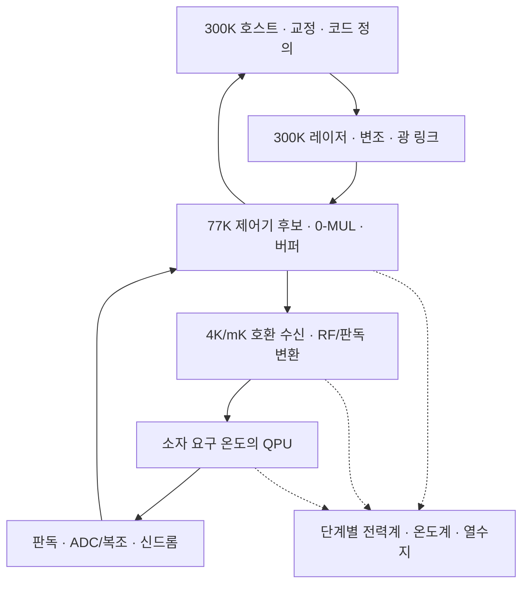

# AXON Quantum Tech — 0-MUL·광 인터커넥트·77K 제어 시스템 검토 및 설계안 v0.2

작성일: 2026-10-30 KST. 대상: 제공된 벤치마크 및 광학·극저온 양자 기술 설명.

추가 제공된 1,000큐비트 랙의 AI·슈퍼컴퓨팅 응용 주장은 함께 제공하는 `AI_AND_HPC_CLAIMS.md`에서 검토했다.

**전체 판정: 0-MUL과 광 인터커넥트는 연구할 가치가 있는 고전 제어 기술이다. 제공 자료만으로 77K 양자컴퓨터, 1,000큐비트·0.45W, 4ns QEC, 비용·전력 절감 배수를 입증하지 못한다. 우선 상온 검증기를 만들고, 이후 77K 제어 보드와 소자별 저온 QPU를 분리하는 구조가 타당하다.**

## 1. 검토 범위와 증거 상태

이번에 직접 확인한 것은 공개 원문·공식 기술 자료, 제공된 숫자의 산술, 새 공학 계산 모델의 실행 결과이다. 제공문에 기록된 `ab32429`, `927a107`, `94dac01` 커밋, Rust 테스트 4개, RTL 20,000벡터, Rust 200,000벡터 결과는 사용자 제공 보고로만 확보했다. 원시 로그·RTL·원본 Rust 코드는 읽지 못했다.

현재 연결로 `Axon-Labs-Org/axon-quantum-tech` 루트와 `src/bin/scale_sim.rs`를 읽으려 했으나 404가 반환됐다. 이는 저장소 부재를 증명하지 않으며 권한 범위 문제일 수 있다. 로컬 Windows의 `D:\axon-양자기술`, `H:\.hermes`에도 이번 환경에서 접근하지 않았다. 따라서 원본 수정·원격 반영·기존 테스트 재현을 주장하지 않는다.

이번 환경에는 Python이 있으며 Cargo/Rust, Yosys, OpenSTA, Icarus Verilog 실행기는 확인되지 않았다. 이에 **외부 패키지가 필요 없는 Python 공학 계산 모델을 별도 작성**했다. 이 모델은 Rust 기존 엔진의 대체 구현이나 양자 상태 시뮬레이터가 아니다.

표의 `[SIMULATED]`는 제공 보고가 주장하는 증거 유형이며, 재현 확인 여부는 판정 열로 별도 표시한다. `[SYNTHESIZED]` 등은 구현 단계 보조 표시이다.

## 2. 주요 주장별 판정

| 주장 | 값 | 증거 라벨 | 적용 범위 | 비교 기준·조건 | 계산/출처 | 한계 | 판정 |
|---|---:|---|---|---|---|---|---|
| Sign-Select가 삼진 곱셈과 동일 | RTL 2만·Rust 20만 벡터 오류 0 | [SIMULATED] 보고 | [AXON-SPECIFIC] | 동일 입력·비트폭·누산 규칙 필요 | 제공 보고 | 원본 및 로그 미확보, 전수 동치 증명 아님 | 미검증 |
| C의 곱셈기 제거 | `$mul` 0 | [SIMULATED][SYNTHESIZED] 보고 | [CPNPU/TRAM-DEPENDENT] | 합성 전후 IR 단계 명시 필요 | 제공 보고 | 연산자 수와 물리 셀 수 구별 필요 | 미검증 |
| 제공된 면적 지표에서 C가 B보다 큼 | B 296, C 338 | [DERIVED] | [AXON-SPECIFIC] | 제공된 같은 임의 GE 지표 한정 | 338/296−1=+14.19% | 산술만 확인; 실제 표준셀 면적 아님 | 검증됨 |
| C 스위칭이 B보다 낮음 | 약 4.48~29.90% | [DERIVED] | [AXON-SPECIFIC] | 제공 VCD 토글 대리 지표 한정 | 128/134−1 등 | 부하 C·전압·글리치 미반영 | 추정 |
| 모든 연산 발열이 40배 감소 | 18→0.45mW/Q | [ASSUMED] | [PROJECTED-AXON] | 동일 회로·품질·주파수 자료 필요 | 상수의 비율 | PDK·전력 추출 근거 없음 | 미검증 |
| 광섬유가 전도 열부하를 줄임 | 구조에 따라 다름 | [MEASURED] 외부 연구 | [GENERAL] | 광·전 변환 포함 설계 | S2 | 열 유입 0이나 AXON 배수 증명 아님 | 조건부 가능 |
| MZI 상쇄로 에너지가 사라짐 | 0mW | [THEORETICAL] 검산 | [GENERAL] | 이상적 수동·무손실 2출력 MZI | 두 출력 전력 합은 입력과 같음 | 선택 출력의 dark와 전체 전력 혼동 | 반증됨 |
| 500μm 전파가 전체 제어 지연 | 5.8ps | [DERIVED] | [PROJECTED-AXON] | 군굴절률·경로 길이 명시 | t=n_g L/c | 변조·검출·ADC·디코더 제외 | 비교 불가 |
| 40~45dB면 양자 제어 품질 충족 | L2 1.39~0.78% | [SIMULATED] 보고 | [PROJECTED-AXON] | 행렬·위상·노이즈 모델 한정 | 제공 스위프 | 양자 게이트 충실도 측정 없음 | 미검증 |
| CMOS·광학 보드가 77K에서 반드시 작동 | 0.5V, 이동도 3~4배 | [ASSUMED] | [PROJECTED-AXON] | 공정·부품·패키지별 검증 필요 | 제공 설명 | 전압·문턱·SRAM·아날로그·CTE 문제 | 미검증 |
| 일반 초전도 트랜스몬을 77K로 대체 | 77K | [THEORETICAL] 및 소자 조건 | [GENERAL] | 통상 GHz 트랜스몬 | 열점유 계산·초전도 조건 | 소자 자체를 바꾸는 별도 연구와 구별 | 반증됨 |
| 스핀·중성원자 모두 77K 보드에 직결 | 보편적 주장 | [ASSUMED] | [PROJECTED-AXON] | 소자별 온도·진공·레이저 필요 | S3·S6 | 온도 단계와 원자 운동온도 혼동 | 미검증 |
| 기존 초전도 방식이 100Q부터 불가능 | 100Q 열폭주 | [ASSUMED] | [GENERAL] 주장 | 같은 실제 냉동기·각 단계 부하 필요 | S1의 Condor 반례 | 상온·4K·mK 열배치 혼합 | 반증됨 |
| 1,000Q의 전체 열부하 | 0.45W | [DERIVED] | [PROJECTED-AXON] | 0.45mW/Q만 합산 | 1000×0.00045W | 코어 외 회로·광흡수·정적 열부하 누락 | 미검증 |
| 전체 벽전력 | 5.4W | [DERIVED] | [PROJECTED-AXON] | 0.45×12 계산 한정 | 가정한 냉각 페널티 곱 | 호스트·레이저·고정부하·질소 생산 제외 | 미검증 |
| QEC 전체 루프 | 4ns·세계 최초 | [ASSUMED] | [PROJECTED-AXON] | 코드·거리·판독·큐잉·피드백 포함 필요 | S4의 기존 실시간 디코딩 | 내부 연산과 전체 루프 혼동 | 미검증 |
| 구축비 26배 절감 | $7.8M→$0.295M | [ASSUMED] | [PROJECTED-AXON] | 같은 QPU·기능·수량·시설 범위 필요 | 견적 없음 | 다른 소자·냉각 구조를 같은 성능으로 취급 | 비교 불가 |
| 액체·기포 영향 100% 차단 | 0% 왜곡 | [ASSUMED] | [PROJECTED-AXON] | 클래딩 두께·모드·커플러·응력 필요 | 파동광학·S7 | 외부 중첩·패키지·온도·진동 영향 잔존 | 미검증 |

## 3. 유지할 기술과 고쳐야 할 해석

### 3.1 0-MUL은 유효한 산술 구현이다

삼진 가중치 w∈{−1,0,+1}에 대해 wx는 −x, 0, +x로 구현할 수 있다. 이것은 정확한 산술 항등식이다. signed int8의 −128에 −1을 곱하면 +128이므로, 부호 반전 전에 폭을 확장해야 한다. 누산기의 wrap·saturation 규칙도 기준선과 동일해야 한다.

하지만 동작 중 메모리, 클럭 트리, 주소 생성기, 가산기, I/O, 판독 회로 전력은 남는다. RTL에서 `w==0`일 때 0을 출력하는 것만으로 앞단 입력 스위칭이 차단되는 것도 아니다. 실제 절감에는 operand isolation·clock enable 등을 같은 조건으로 비교해야 한다.

제공 결과의 핵심은 C 대 A보다 **동일 삼진 기능인 C 대 B**다. C는 B보다 게이트 개수는 2.88% 적지만, 임의 가중 면적은 14.19% 크고 논리 깊이 대리 지표는 8.70% 작다. 이 지표들은 서로 다른 것을 재므로 모순이 아니다. 게이트 수만으로 면적·지연·전력을 확정할 수 없다.

16레인에서 4레인으로 줄인 결과도 레인당 특성이 그대로 유지된다고 보장할 수 없다. 공유 제어, 가산 트리, fan-out, 배선, 파이프라인 비용이 달라진다. 4·16·64레인은 각각 측정해야 한다. no-ABC 결과는 기술 독립 논리 비교로 보존하되, 매핑 실패 원인을 해결한 뒤 표준셀 기준으로 비교해야 한다.

### 3.2 광 간섭은 에너지를 재분배한다

이상적인 무손실 MZI의 한 입력에 광전력 P를 넣으면 출력은 다음과 같다.

P₁=P cos²(Δφ/2), P₂=P sin²(Δφ/2), P₁+P₂=P.

Δφ=π에서 P₁이 0이 되어도 P₂로 전력이 나온다. 실제 소자는 흡수·산란 손실도 가진다. dark port를 0으로 사용하는 논리 설계는 가능하지만, 레이저와 위상 설정·유지, 검출기, termination 등의 에너지는 별도로 계산한다. 정적으로 설정된 수동 경로의 추가 전기 구동이 매우 작을 수 있다는 설명과 ‘시스템 전력이 0’이라는 주장은 다르다.

또한 광학 부호를 ±위상으로 표현해도, 보통 광검출기는 |E|²를 읽는다. 음수 부호를 포함한 선형 합을 읽으려면 coherent/LO 기반 balanced detection, dual-rail 또는 별도 양·음 누산 같은 회로가 필요하다. balanced detector를 붙였다는 설명만으로 임의 GEMV의 정확한 선형성이 성립하지 않는다. 실제 광장 전달식과 검출 전류식을 먼저 명시해야 한다.

고전 광컴퓨팅 행렬 연산은 곧바로 양자 게이트가 되지 않는다. 양자 연산은 선택한 인코딩에서 손실·잡음·측정·허용 변환을 따로 검증해야 하며, 고전 제어용 photodiode와 양자 데이터 경로의 검출기를 구분한다.

### 3.3 5.8ps는 가능한 경로 전파 계산일 뿐이다

t=n_gL/c. L=500μm, n_g=3.48을 가정하면 5.804ps, n_g=4.0을 가정하면 6.671ps이다. 두 n_g 모두 이번 검산용 가정이며 실제 모드·파장별 군굴절률이 아니다. 위상굴절률을 그대로 군굴절률로 쓰면 안 된다.

전체 폐루프는 `측정 적분 + ADC/복조 + 전송/버퍼 + 디코딩/큐잉 + DAC/구동 + 펄스 전달`이다. 광섬유 자체도 n_g=1.5라는 가정에서 편도 약 5ns/m가 걸린다. 따라서 mm급 칩 경로 지연으로 m급 시스템의 4ns 루프를 설명할 수 없다.

### 3.4 77K 제어기의 가능성과 77K QPU는 다르다

5GHz의 에너지 간격은 hf/k_B=0.23996K이다. 열평형 2준위 모형에서 여기 확률은 `p_e=1/(1+exp(hf/k_BT))`다.

| 온도 | 열평형 여기 확률 [THEORETICAL] |
|---:|---:|
| 15mK | 약 0.000000113 |
| 4K | 약 0.4850 |
| 77K | 약 0.4992 |

이는 왜 GHz 소자를 단순히 77K로 올릴 수 없는지를 보여주는 직관적 모형이다. 실제 트랜스몬의 다준위 구조·비평형 점유·능동 초기화·오류율을 대신하지 않으며, 다른 큐비트 방식 전체를 금지하는 법칙으로 사용해서는 안 된다.

실리콘 스핀의 고온 동작은 실제 연구 분야이지만, S3의 고충실도 실증은 1K 이상 영역이다. 이를 77K 범용 QPU가 검증됐다는 뜻으로 확대할 수 없다. NV 전자스핀 제어·센싱, 핵스핀 메모리, 광학 얽힘 인터페이스도 요구 조건이 서로 다르다. 중성원자는 진공에서 레이저로 포획·냉각하며, 챔버 벽이 상온 또는 저온이라는 사실과 원자 운동온도는 구별한다. S6은 상온 진공 챔버를 사용하는 대규모 원자 배열 사례이다.

광자 QPU는 일부 소자의 상온 동작이 장점이지만, 전체 시스템은 소스·손실·스위치·광검출 조건에 좌우된다. S5의 Aurora도 대부분의 구성품은 상온에서 동작하나 cryogenic detection array가 별도로 있다. 따라서 ‘광자 방식이면 LN2만으로 전부 완성’도 성립하지 않는다.

### 3.5 실시간 QEC의 기준을 고쳐야 한다

QEC는 오류 신드롬을 반복 측정하고 코드에 맞게 해석하는 과정이다. GF(2) XOR, lookup, matching, union-find, 신경망 등 디코더별 연산이 다르다. 큰 삼진 GEMV를 계산했다는 사실만으로 QEC가 구현된 것은 아니다.

기존 연구 S4에는 1.1μs syndrome cycle과 평균 63μs 실시간 디코더 지연이 함께 보고되어 있다. 지연과 처리율이 다를 수 있으며, Pauli frame을 추적해 즉각 물리 펄스를 생략하는 경우도 있다. 해당 논문은 추가 reaction time과 feedback 미구현도 명시한다. 이를 완전한 즉시 피드백 실증이라고 부르지는 않는다. 반대로 ‘수백 ns만 걸려도 큐비트가 이미 죽는다’는 일반화 역시 틀리다.

AXON은 먼저 하나의 코드·거리·오류모형을 선정하고 디코더 정확도, 논리 오류율, 처리율, 평균 및 꼬리 지연을 같이 비교해야 한다. 4ns는 전체 QEC 성능으로 사용하지 않고, 필요하면 **특정 고정폭 조합회로의 목표 지연**으로만 정의한다.

## 4. 열·전력·배선 모델 재작성

### 4.1 열원은 온도 단계마다 배치한다

각 단계 j의 냉각 요구량을 다음처럼 분리한다.

Q_j = P_logic,j + P_memory/clock,j + P_ADC/DAC/RF,j + P_readout,j + P_bias,j + P_regulator_loss,j + P_optical_absorbed,j + Q_conduction,j + Q_radiation,j.

도선·광섬유의 전도 열은 재료와 실제 열고정 구간별로 `Q=(A/L)∫k(T)dT`를 적분한다. 같은 재료라도 단면, 길이, coating, ferrule, feedthrough가 달라지면 달라진다. 금속과 광섬유의 열전도율 비가 전체 시스템 전력 절감 배수가 되는 것도 아니다. NIST의 광 링크 실증은 방향성을 지지하지만 AXON 수치는 별도 시험이 필요하다. 광전 변환부의 소산과 흡수광은 반드시 해당 온도 단계에 넣는다. [S2]

상온 AWG의 소비 전력을 전부 4K에서 발생하는 열로 합산하는 것은 잘못이다. 반대로 77K 제어기만 계산하고 4K/mK 수신기·배선·QPU를 빼는 것도 잘못이다. 4K 냉각 용량과 15mK 냉각 용량은 서로 다른 값이다.

### 4.2 냉각의 이상적 하한과 실제 벽전력을 분리한다

상온 300K로 열을 버리는 가역 냉동기의 최소 입력은 `W_min=Q_cold(300−T_cold)/T_cold`이다.

| 온도 | 1W 제거당 이상적 최소 일 [THEORETICAL] |
|---:|---:|
| 77K | 2.896W |
| 4K | 74W |
| 15mK | 19,999W |

실제 냉각기는 이상적 하한보다 더 많은 전력을 쓰고 고정부하·보조장치도 가진다. 위 표는 구매한 LN2의 생산 에너지, 증발 손실, 물류 비용을 계산한 것이 아니다. 액체질소 배스 방식과 폐회로 냉각기의 효율을 하나의 고정 곱셈계수로 통일하면 안 된다.

제공된 1,000Q의 0.45W는 `1000×0.45mW`라는 가정 기반 코어 합계다. 5.4W는 여기에 12를 곱한 산술이다. 두 식은 맞지만 입력 근거와 시스템 경계가 부족하다. 전체 양자컴퓨터 전력으로 사용할 수 없다.

### 4.3 배선 16가닥은 특정 채널 계획일 뿐이다

독립 방향별 동일 구성을 가정하면 `N_fiber=ceil(N_Q×channels_per_Q/(wavelengths×streams_per_wavelength))×directions`이다.

1,000Q·1채널/Q·64파장·단방향이면 16가닥이다. 3채널/Q·64파장·입출력 두 방향 별도 섬유이면 94가닥이다. 두 숫자 모두 산술 예시이다. 실제 구현은 복조, 시간분할, readout multiplexing, RF 주파수 대역, 선폭·크로스토크, 동기화 조건으로 결정된다.

기존 3,000개 선과 광 16개를 비교하려면, 광 쪽이 동일한 파형·판독·동시성 요구를 어떻게 수용하는지 설명해야 한다. WDM 채널 수만 정한다고 ADC/DAC 및 큐비트 접속부가 사라지지 않는다.

### 4.4 새 모델의 예시 출력

`inputs_unknown.json`은 77K·4K·15mK의 열부하와 전체 지연·벽전력을 미입력 상태로 둔다. 출력은 `UNKNOWN` 또는 null이다. 누락 입력을 0으로 채우지 않는다.

`inputs_illustrative.json`은 **77K 장부에만 임의 가정값**을 넣은 예제다. 제어 코어 0.45mW/Q, 판독 2mW/Q, DAC/RF 1mW/Q, 방향성 신호당 광흡수 0.1mW, 고정 합계 0.8W, 섬유당 전도 0.01mW를 가정했다. 이 값들은 AXON이나 상용 부품의 성능 자료가 아니다.

1,000Q, 3채널/Q, 양방향 별도 94섬유에서 77K 합계는 **4.85094W [DERIVED FROM ASSUMED INPUTS]**다. 계산은 0.45+2+1+0.6+0.8+0.00094W이다. 다른 단계와 벽전력은 여전히 미확인이다. 이 숫자는 원래 0.45W의 대안 성능 예측이 아니라, 누락 경계의 영향을 드러내는 입력 예제다.

코어와 광흡수 입력을 바꾼 민감도 예제도 포함했다. 전체 비용, QEC 성공 여부, 양산 가능성은 계산하지 않는다.

## 5. 광학·패키징 검토

Si 코어와 SiO₂ 클래딩은 외부 액체의 직접 영향을 줄일 수 있다. 그러나 도파 모드는 유한한 클래딩 안에 evanescent tail을 가지며, 충분한 두께인지 확인해야 한다. 노출된 grating/edge coupler, 표면 도파로, 접착제, fiber attach는 별도 검토 대상이다.

또한 냉각으로 Si·SiO₂의 굴절률과 길이·응력이 변한다. NASA S7은 굴절률의 온도 의존성을 직접 측정했다. ‘77K에서도 굴절률 변화 없음’은 유지할 수 없다. 열광학 계수가 작아질 수 있어도 위상 안정성이 자동 보장되지는 않는다. 제조 오차, 레이저 드리프트, 전하·기계 잡음, 패키지 수축도 남는다. 4K 결과를 77K의 정확한 10배 개선값으로 가져오면 안 된다.

저온에서 thermal tuner가 약해지는 것은 튜닝에 불리한 면도 있다. 77K에서 필요한 위상 범위와 구동 전력, calibration 주기를 측정하고, 부품별 동작이 검증된 튜닝 방식을 선택한다.

낮은 총전력만으로 기포가 없다고 보장할 수 없다. 열유속 q''=P/A, 표면 상태, 압력, 포화도, hot spot, 냉각 시작 과정이 중요하다. critical heat flux는 단순한 ‘비등 시작점’이 아니므로 그 이하라는 이유로 비등이 없다고 결론내릴 수 없다.

권장 초기 구조는 **진공 내 보드 + 온도센서 + 히터 제어 + 구리 cold finger/thermal strap**이다. LN2는 열원에서 떨어진 냉각원으로 사용한다. 그러나 접촉열저항과 부하 때문에 다이 온도는 배스 온도와 같지 않을 수 있다. 냉각원 77K와 실제 다이 온도를 별도로 기록한다. 구리 strap이나 일반 thermal pad를 ‘77K 초전도 패드’라 부르지 않는다.

일반 부품의 정격만으로 77K 사용을 보증하지 않는다. FPGA/ASIC, SRAM, ADC/DAC, RF 증폭기, oscillator/PLL, PD/TIA, DC-DC, capacitor, connector, solder 및 fiber attach의 저온 동작과 열사이클 신뢰성을 각각 확인한다. 침지와 진공 전도 냉각은 별도 패키징 시험이다.

## 6. 세 가지 개발 경로

| 경로 | 구현 범위 | 장점 | 부담·한계 | 위치 |
|---|---|---|---|---|
| A: 상온 제어 검증기 | FPGA의 삼진 MAC/파형 합성 또는 디코더 + 전기 loopback + 선택적 광 링크 | 현재 기술로 기능·품질·에너지 비교 가능 | 극저온·QPU 성능 입증은 별도 | 즉시 착수 권장 |
| B: 77K 제어 + 저온별 QPU | 검증된 제어 부품을 77K에 배치, 필요한 4K/mK 변환·QPU 유지 | 제어부 저전력화와 배선 개선을 분리 검증 | 저온 부품 모델·패키지·광흡수 열부하 필요 | 중기 권장 목표 |
| C: 광자/NV 등 별도 QPU 연구 | 구체 소자·게이트·검출·광원·온도 조건을 먼저 선정 | 기존 광 자산과 결합 연구 가능 | 새로운 QPU 연구이며 보드 실장만으로 해결되지 않음 | 독립 장기 트랙 |

권장 순서는 A→B이다. C는 분리된 연구 목표로 유지할 수 있다. A에서 0-MUL이 같은 삼진 baseline보다 이기지 못하면, 그 결과를 보존하고 응용 또는 구조를 좁힌다.

## 7. 권장 하이브리드 시스템

이 구조는 제안 [TARGET]이며 제작·실측 완료 설계가 아니다.

광 링크를 77K까지 보낼지 더 낮은 단계까지 보낼지 먼저 고정하지 않는다. 수신부의 소산·변환 품질·배선 열부하를 측정하여 배치한다. 전원선·바이어스선·출력 RF 경로도 도식 외 실제 인터페이스 목록에 포함한다. 초전도 QPU는 광섬유로 신호를 보낸다는 이유만으로 직접 광 구동되는 것이 아니다.

## 8. 최소 실험과 진입 기준

| 단계 | 수행 항목 | 합격 기준 또는 의사결정 기준 | 증거 |
|---|---|---|---|
| P0 원본 회수 | 원본 커밋, RTL, JSON, EDA 로그, seed, 도구·PDK 버전 고정 | 입력부터 결과까지 동일 명령 재현 | CODE/RTL 검증 |
| P1 산술 동치 | −128 포함 directed test, random, 동일 wrap/saturate, 가능하면 formal | B↔C 기능 오차 0; 미정·overflow 처리 명시 | RTL-VERIFIED |
| P2 공정한 PPA | 동일 pipeline/clock/output width, B와 C 중심 비교, 4/16/64레인 | area·timing·energy/op·동일 기능을 함께 보고 | SYNTHESIZED |
| P3 상온 보드 | 전기 loopback·선택 광 링크, 실제 waveform 또는 decoder task | 기준선 대비 품질 유지와 전체 전력 차이 측정; 실패도 기록 | FPGA-MEASURED |
| P4 77K coupon | 부품별 전압·온도 sweep, 광손실/위상/PD/TIA·패키지 시험 | 사전 요구조건 내 기능·잡음·드리프트 유지; 열사이클 기준 충족 | MEASURED |
| P5 단계별 광 링크 | 수신 위치별 absorbed optical power, RF 품질·열부하 측정 | 모든 단계 열수지 닫힘, 해당 QPU 입력 규격 충족 | MEASURED |
| P6 실제 QPU | 특정 소자에서 calibration·게이트·판독·QEC 검증 | 동등 조건 baseline과 논리 오류율·처리율·꼬리 지연 비교 | QPU 실험 |

Sky130+OpenSTA는 다음 검증 단계로 적절하지만 **합성·라이브러리 기반 전력/타이밍 추정**이다. 실리콘 실측이라고 쓰지 않는다. S8 문서는 Liberty 기반 지연 모델과 power activity를 설명한다. 기생배선을 읽지 않으면 실제 배선 효과가 포함되지 않는다.

상온 또는 공개 코너의 Liberty/SPICE 결과를 77K나 4K 결과로 외삽하지 않는다. cryogenic compact model과 온도별 cell characterization이 확보되기 전까지 77K Fmax·전력·0.5V 동작값은 미검증이다. SKY130 공식 코너 명명 예시 S9는 지정 온도를 기록하는 방법을 보여줄 뿐 저온 보증이 아니다.

## 9. 외부 문서용 수정 문구

> AXON Quantum Tech는 삼진 Sign-Select 연산과 광 인터커넥트를 이용해 양자 시스템의 고전 제어부 연산·배선 부담을 줄이는 후보 구조이다. 제공된 기능 시뮬레이션 보고와 별도 공학 계산은 실리콘 전력, 77K QPU 동작 또는 종단 간 QEC 성능의 실증이 아니다. 다음 단계는 동일 삼진 기준선의 PPA 비교와 상온 보드 검증이며, 극저온 적용은 부품·광변환·패키지 및 단계별 열수지 시험으로 판단한다.

## 10. 누락 근거와 최소 다음 실험

**누락 근거:** 원본 코드·커밋과 raw log, signedness/폭 정의, PDK/Liberty hash, VCD·SAIF·SDF 및 시간창, 합성 제약, 광장/검출기 전달식, 실제 cooling curve, 부품별 77K 시험, 대상 QPU 및 QEC 코드, 공급업체 견적.

**최소 다음 실험:** 상온에서 B 삼진 곱셈과 C Sign-Select를 같은 4레인·같은 signed int8 입력·동일 0 비율·동일 파이프라인·같은 출력 부하로 구현한다. −128 부호 반전과 누산 overflow를 포함해 기능을 검증한 뒤, 표준셀 라이브러리로 매핑하고 timing과 energy/op를 함께 추정한다. 0-MUL 우위는 그 조건에서 측정값이 지지할 때만 보고한다. 그 다음 16·64레인과 실제 파형 또는 QEC 디코더 품질을 평가한다.

## 11. 출처

아래는 공식 발표·원 논문·공식 도구 문서이다. 열람 기준일 2026-10-30. 수치의 원 출처와 AXON에 대한 추론은 본문에서 구별했다. 특허 34/35 원문은 이번에 열람하지 않아 청구항·신규성·권리범위에 대한 판정은 포함하지 않는다.

- **S1** IBM, 2023-12-04, Condor 1,121 superconducting qubits 및 한 희석냉동기 내 고밀도 cryogenic flex wiring. https://www.ibm.com/quantum/blog/quantum-roadmap-2033
- **S2** Lecocq et al., Nature 591, 575–579 (2021), 광 링크 기반 초전도 큐비트 control/readout. NIST 공식 요약: https://www.nist.gov/publications/control-and-readout-superconducting-qubit-using-photonic-link ; 원 논문 https://doi.org/10.1038/s41586-021-03268-x
- **S3** Huang et al., Nature 627, 772–777 (2024), High-fidelity spin qubit operation and algorithmic initialization above 1 K. https://doi.org/10.1038/s41586-024-07160-2
- **S4** Google Quantum AI and Collaborators, Nature 638, 920–926 (2025), Quantum error correction below the surface code threshold. https://doi.org/10.1038/s41586-024-08449-y ; 공개 전문 https://pmc.ncbi.nlm.nih.gov/articles/PMC11864966/ . 2026-04-28 저자 정정 공지가 있음: https://doi.org/10.1038/s41586-026-10559-8 . 정정 본문은 접근되지 않았으며, 본문 수치는 검색 가능한 현행 논문 텍스트에 근거함.
- **S5** Nature 638, 912–919 (2025), Scaling and networking a modular photonic quantum computer. https://doi.org/10.1038/s41586-024-08406-9
- **S6** Nature 647, 60–67 (2025), A tweezer array with 6,100 highly coherent atomic qubits. https://doi.org/10.1038/s41586-025-09641-4
- **S7** Frey, Leviton & Madison (2006), Temperature-dependent Refractive Index of Silicon and Germanium, NASA NTRS 20070021411. https://ntrs.nasa.gov/citations/20070021411
- **S8** OpenSTA official Examples, timing analysis and power analysis. https://github.com/The-OpenROAD-Project/OpenSTA/blob/master/doc/Examples.md
- **S9** SKY130 official Python API, process/voltage/temperature corner filenames. https://skywater-pdk.readthedocs.io/en/main/python-api/skywater_pdk.html
