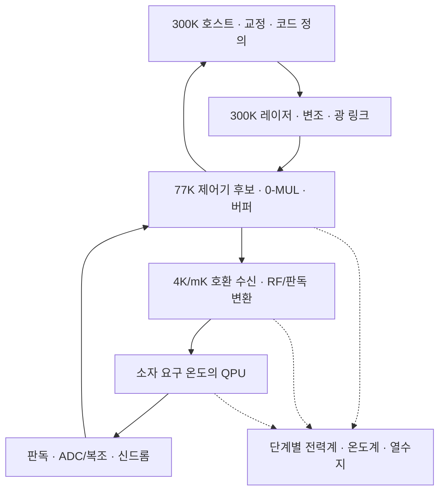
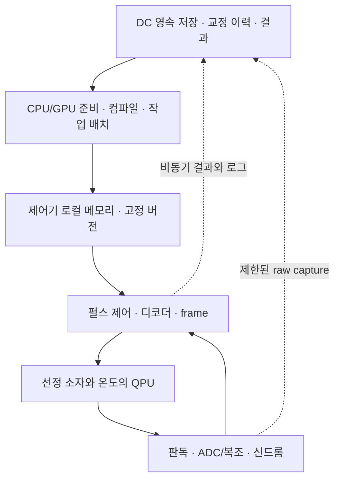

# AXON Quantum 통합 검토 v0.2

2026-10-30 KST

**권장 목표: AXON DC + CPU/GPU + 로컬 0-MUL 제어기 + 광 인터커넥트 + 소자별 QPU의 하이브리드 연구 인프라.**

77K 1,000큐비트 완제품·4ns QEC·5.4W 전체 전력·범용 AI/HPC 대체는 이번 증거로 입증되지 않았다. 이 자료는 설계·감사 및 공학 계산이며 실리콘 또는 양자컴퓨터 제작 실측 보고가 아니다.

구성: 1부 물리·회로·극저온, 2부 AI/HPC, 3부 DC/메모리, 4부 실행 작업지시서.

# AXON Quantum Tech — 0-MUL·광 인터커넥트·77K 제어 시스템 검토 및 설계안 v0.2

작성일: 2026-10-30 KST. 대상: 제공된 벤치마크 및 광학·극저온 양자 기술 설명.

추가 제공된 1,000큐비트 랙의 AI·슈퍼컴퓨팅 응용 주장은 함께 제공하는 `AI_AND_HPC_CLAIMS.md`에서 검토했다.

**전체 판정: 0-MUL과 광 인터커넥트는 연구할 가치가 있는 고전 제어 기술이다. 제공 자료만으로 77K 양자컴퓨터, 1,000큐비트·0.45W, 4ns QEC, 비용·전력 절감 배수를 입증하지 못한다. 우선 상온 검증기를 만들고, 이후 77K 제어 보드와 소자별 저온 QPU를 분리하는 구조가 타당하다.**

## 1. 검토 범위와 증거 상태

이번에 직접 확인한 것은 공개 원문·공식 기술 자료, 제공된 숫자의 산술, 새 공학 계산 모델의 실행 결과이다. 제공문에 기록된 `ab32429`, `927a107`, `94dac01` 커밋, Rust 테스트 4개, RTL 20,000벡터, Rust 200,000벡터 결과는 사용자 제공 보고로만 확보했다. 원시 로그·RTL·원본 Rust 코드는 읽지 못했다.

현재 연결로 `Axon-Labs-Org/axon-quantum-tech` 루트와 `src/bin/scale_sim.rs`를 읽으려 했으나 404가 반환됐다. 이는 저장소 부재를 증명하지 않으며 권한 범위 문제일 수 있다. 로컬 Windows의 `D:\axon-양자기술`, `H:\.hermes`에도 이번 환경에서 접근하지 않았다. 따라서 원본 수정·원격 반영·기존 테스트 재현을 주장하지 않는다.

이번 환경에는 Python이 있으며 Cargo/Rust, Yosys, OpenSTA, Icarus Verilog 실행기는 확인되지 않았다. 이에 **외부 패키지가 필요 없는 Python 공학 계산 모델을 별도 작성**했다. 이 모델은 Rust 기존 엔진의 대체 구현이나 양자 상태 시뮬레이터가 아니다.

표의 `[SIMULATED]`는 제공 보고가 주장하는 증거 유형이며, 재현 확인 여부는 판정 열로 별도 표시한다. `[SYNTHESIZED]` 등은 구현 단계 보조 표시이다.

## 2. 주요 주장별 판정

| 주장 | 값 | 증거 라벨 | 적용 범위 | 비교 기준·조건 | 계산/출처 | 한계 | 판정 |
|---|---:|---|---|---|---|---|---|
| Sign-Select가 삼진 곱셈과 동일 | RTL 2만·Rust 20만 벡터 오류 0 | [SIMULATED] 보고 | [AXON-SPECIFIC] | 동일 입력·비트폭·누산 규칙 필요 | 제공 보고 | 원본 및 로그 미확보, 전수 동치 증명 아님 | 미검증 |
| C의 곱셈기 제거 | `$mul` 0 | [SIMULATED][SYNTHESIZED] 보고 | [CPNPU/TRAM-DEPENDENT] | 합성 전후 IR 단계 명시 필요 | 제공 보고 | 연산자 수와 물리 셀 수 구별 필요 | 미검증 |
| 제공된 면적 지표에서 C가 B보다 큼 | B 296, C 338 | [DERIVED] | [AXON-SPECIFIC] | 제공된 같은 임의 GE 지표 한정 | 338/296−1=+14.19% | 산술만 확인; 실제 표준셀 면적 아님 | 검증됨 |
| C 스위칭이 B보다 낮음 | 약 4.48~29.90% | [DERIVED] | [AXON-SPECIFIC] | 제공 VCD 토글 대리 지표 한정 | 128/134−1 등 | 부하 C·전압·글리치 미반영 | 추정 |
| 모든 연산 발열이 40배 감소 | 18→0.45mW/Q | [ASSUMED] | [PROJECTED-AXON] | 동일 회로·품질·주파수 자료 필요 | 상수의 비율 | PDK·전력 추출 근거 없음 | 미검증 |
| 광섬유가 전도 열부하를 줄임 | 구조에 따라 다름 | [MEASURED] 외부 연구 | [GENERAL] | 광·전 변환 포함 설계 | S2 | 열 유입 0이나 AXON 배수 증명 아님 | 조건부 가능 |
| MZI 상쇄로 에너지가 사라짐 | 0mW | [THEORETICAL] 검산 | [GENERAL] | 이상적 수동·무손실 2출력 MZI | 두 출력 전력 합은 입력과 같음 | 선택 출력의 dark와 전체 전력 혼동 | 반증됨 |
| 500μm 전파가 전체 제어 지연 | 5.8ps | [DERIVED] | [PROJECTED-AXON] | 군굴절률·경로 길이 명시 | t=n_g L/c | 변조·검출·ADC·디코더 제외 | 비교 불가 |
| 40~45dB면 양자 제어 품질 충족 | L2 1.39~0.78% | [SIMULATED] 보고 | [PROJECTED-AXON] | 행렬·위상·노이즈 모델 한정 | 제공 스위프 | 양자 게이트 충실도 측정 없음 | 미검증 |
| CMOS·광학 보드가 77K에서 반드시 작동 | 0.5V, 이동도 3~4배 | [ASSUMED] | [PROJECTED-AXON] | 공정·부품·패키지별 검증 필요 | 제공 설명 | 전압·문턱·SRAM·아날로그·CTE 문제 | 미검증 |
| 일반 초전도 트랜스몬을 77K로 대체 | 77K | [THEORETICAL] 및 소자 조건 | [GENERAL] | 통상 GHz 트랜스몬 | 열점유 계산·초전도 조건 | 소자 자체를 바꾸는 별도 연구와 구별 | 반증됨 |
| 스핀·중성원자 모두 77K 보드에 직결 | 보편적 주장 | [ASSUMED] | [PROJECTED-AXON] | 소자별 온도·진공·레이저 필요 | S3·S6 | 온도 단계와 원자 운동온도 혼동 | 미검증 |
| 기존 초전도 방식이 100Q부터 불가능 | 100Q 열폭주 | [ASSUMED] | [GENERAL] 주장 | 같은 실제 냉동기·각 단계 부하 필요 | S1의 Condor 반례 | 상온·4K·mK 열배치 혼합 | 반증됨 |
| 1,000Q의 전체 열부하 | 0.45W | [DERIVED] | [PROJECTED-AXON] | 0.45mW/Q만 합산 | 1000×0.00045W | 코어 외 회로·광흡수·정적 열부하 누락 | 미검증 |
| 전체 벽전력 | 5.4W | [DERIVED] | [PROJECTED-AXON] | 0.45×12 계산 한정 | 가정한 냉각 페널티 곱 | 호스트·레이저·고정부하·질소 생산 제외 | 미검증 |
| QEC 전체 루프 | 4ns·세계 최초 | [ASSUMED] | [PROJECTED-AXON] | 코드·거리·판독·큐잉·피드백 포함 필요 | S4의 기존 실시간 디코딩 | 내부 연산과 전체 루프 혼동 | 미검증 |
| 구축비 26배 절감 | $7.8M→$0.295M | [ASSUMED] | [PROJECTED-AXON] | 같은 QPU·기능·수량·시설 범위 필요 | 견적 없음 | 다른 소자·냉각 구조를 같은 성능으로 취급 | 비교 불가 |
| 액체·기포 영향 100% 차단 | 0% 왜곡 | [ASSUMED] | [PROJECTED-AXON] | 클래딩 두께·모드·커플러·응력 필요 | 파동광학·S7 | 외부 중첩·패키지·온도·진동 영향 잔존 | 미검증 |

## 3. 유지할 기술과 고쳐야 할 해석

### 3.1 0-MUL은 유효한 산술 구현이다

삼진 가중치 w∈{−1,0,+1}에 대해 wx는 −x, 0, +x로 구현할 수 있다. 이것은 정확한 산술 항등식이다. signed int8의 −128에 −1을 곱하면 +128이므로, 부호 반전 전에 폭을 확장해야 한다. 누산기의 wrap·saturation 규칙도 기준선과 동일해야 한다.

하지만 동작 중 메모리, 클럭 트리, 주소 생성기, 가산기, I/O, 판독 회로 전력은 남는다. RTL에서 `w==0`일 때 0을 출력하는 것만으로 앞단 입력 스위칭이 차단되는 것도 아니다. 실제 절감에는 operand isolation·clock enable 등을 같은 조건으로 비교해야 한다.

제공 결과의 핵심은 C 대 A보다 **동일 삼진 기능인 C 대 B**다. C는 B보다 게이트 개수는 2.88% 적지만, 임의 가중 면적은 14.19% 크고 논리 깊이 대리 지표는 8.70% 작다. 이 지표들은 서로 다른 것을 재므로 모순이 아니다. 게이트 수만으로 면적·지연·전력을 확정할 수 없다.

16레인에서 4레인으로 줄인 결과도 레인당 특성이 그대로 유지된다고 보장할 수 없다. 공유 제어, 가산 트리, fan-out, 배선, 파이프라인 비용이 달라진다. 4·16·64레인은 각각 측정해야 한다. no-ABC 결과는 기술 독립 논리 비교로 보존하되, 매핑 실패 원인을 해결한 뒤 표준셀 기준으로 비교해야 한다.

### 3.2 광 간섭은 에너지를 재분배한다

이상적인 무손실 MZI의 한 입력에 광전력 P를 넣으면 출력은 다음과 같다.

P₁=P cos²(Δφ/2), P₂=P sin²(Δφ/2), P₁+P₂=P.

Δφ=π에서 P₁이 0이 되어도 P₂로 전력이 나온다. 실제 소자는 흡수·산란 손실도 가진다. dark port를 0으로 사용하는 논리 설계는 가능하지만, 레이저와 위상 설정·유지, 검출기, termination 등의 에너지는 별도로 계산한다. 정적으로 설정된 수동 경로의 추가 전기 구동이 매우 작을 수 있다는 설명과 ‘시스템 전력이 0’이라는 주장은 다르다.

또한 광학 부호를 ±위상으로 표현해도, 보통 광검출기는 |E|²를 읽는다. 음수 부호를 포함한 선형 합을 읽으려면 coherent/LO 기반 balanced detection, dual-rail 또는 별도 양·음 누산 같은 회로가 필요하다. balanced detector를 붙였다는 설명만으로 임의 GEMV의 정확한 선형성이 성립하지 않는다. 실제 광장 전달식과 검출 전류식을 먼저 명시해야 한다.

고전 광컴퓨팅 행렬 연산은 곧바로 양자 게이트가 되지 않는다. 양자 연산은 선택한 인코딩에서 손실·잡음·측정·허용 변환을 따로 검증해야 하며, 고전 제어용 photodiode와 양자 데이터 경로의 검출기를 구분한다.

### 3.3 5.8ps는 가능한 경로 전파 계산일 뿐이다

t=n_gL/c. L=500μm, n_g=3.48을 가정하면 5.804ps, n_g=4.0을 가정하면 6.671ps이다. 두 n_g 모두 이번 검산용 가정이며 실제 모드·파장별 군굴절률이 아니다. 위상굴절률을 그대로 군굴절률로 쓰면 안 된다.

전체 폐루프는 `측정 적분 + ADC/복조 + 전송/버퍼 + 디코딩/큐잉 + DAC/구동 + 펄스 전달`이다. 광섬유 자체도 n_g=1.5라는 가정에서 편도 약 5ns/m가 걸린다. 따라서 mm급 칩 경로 지연으로 m급 시스템의 4ns 루프를 설명할 수 없다.

### 3.4 77K 제어기의 가능성과 77K QPU는 다르다

5GHz의 에너지 간격은 hf/k_B=0.23996K이다. 열평형 2준위 모형에서 여기 확률은 `p_e=1/(1+exp(hf/k_BT))`다.

| 온도 | 열평형 여기 확률 [THEORETICAL] |
|---:|---:|
| 15mK | 약 0.000000113 |
| 4K | 약 0.4850 |
| 77K | 약 0.4992 |

이는 왜 GHz 소자를 단순히 77K로 올릴 수 없는지를 보여주는 직관적 모형이다. 실제 트랜스몬의 다준위 구조·비평형 점유·능동 초기화·오류율을 대신하지 않으며, 다른 큐비트 방식 전체를 금지하는 법칙으로 사용해서는 안 된다.

실리콘 스핀의 고온 동작은 실제 연구 분야이지만, S3의 고충실도 실증은 1K 이상 영역이다. 이를 77K 범용 QPU가 검증됐다는 뜻으로 확대할 수 없다. NV 전자스핀 제어·센싱, 핵스핀 메모리, 광학 얽힘 인터페이스도 요구 조건이 서로 다르다. 중성원자는 진공에서 레이저로 포획·냉각하며, 챔버 벽이 상온 또는 저온이라는 사실과 원자 운동온도는 구별한다. S6은 상온 진공 챔버를 사용하는 대규모 원자 배열 사례이다.

광자 QPU는 일부 소자의 상온 동작이 장점이지만, 전체 시스템은 소스·손실·스위치·광검출 조건에 좌우된다. S5의 Aurora도 대부분의 구성품은 상온에서 동작하나 cryogenic detection array가 별도로 있다. 따라서 ‘광자 방식이면 LN2만으로 전부 완성’도 성립하지 않는다.

### 3.5 실시간 QEC의 기준을 고쳐야 한다

QEC는 오류 신드롬을 반복 측정하고 코드에 맞게 해석하는 과정이다. GF(2) XOR, lookup, matching, union-find, 신경망 등 디코더별 연산이 다르다. 큰 삼진 GEMV를 계산했다는 사실만으로 QEC가 구현된 것은 아니다.

기존 연구 S4에는 1.1μs syndrome cycle과 평균 63μs 실시간 디코더 지연이 함께 보고되어 있다. 지연과 처리율이 다를 수 있으며, Pauli frame을 추적해 즉각 물리 펄스를 생략하는 경우도 있다. 해당 논문은 추가 reaction time과 feedback 미구현도 명시한다. 이를 완전한 즉시 피드백 실증이라고 부르지는 않는다. 반대로 ‘수백 ns만 걸려도 큐비트가 이미 죽는다’는 일반화 역시 틀리다.

AXON은 먼저 하나의 코드·거리·오류모형을 선정하고 디코더 정확도, 논리 오류율, 처리율, 평균 및 꼬리 지연을 같이 비교해야 한다. 4ns는 전체 QEC 성능으로 사용하지 않고, 필요하면 **특정 고정폭 조합회로의 목표 지연**으로만 정의한다.

## 4. 열·전력·배선 모델 재작성

### 4.1 열원은 온도 단계마다 배치한다

각 단계 j의 냉각 요구량을 다음처럼 분리한다.

Q_j = P_logic,j + P_memory/clock,j + P_ADC/DAC/RF,j + P_readout,j + P_bias,j + P_regulator_loss,j + P_optical_absorbed,j + Q_conduction,j + Q_radiation,j.

도선·광섬유의 전도 열은 재료와 실제 열고정 구간별로 `Q=(A/L)∫k(T)dT`를 적분한다. 같은 재료라도 단면, 길이, coating, ferrule, feedthrough가 달라지면 달라진다. 금속과 광섬유의 열전도율 비가 전체 시스템 전력 절감 배수가 되는 것도 아니다. NIST의 광 링크 실증은 방향성을 지지하지만 AXON 수치는 별도 시험이 필요하다. 광전 변환부의 소산과 흡수광은 반드시 해당 온도 단계에 넣는다. [S2]

상온 AWG의 소비 전력을 전부 4K에서 발생하는 열로 합산하는 것은 잘못이다. 반대로 77K 제어기만 계산하고 4K/mK 수신기·배선·QPU를 빼는 것도 잘못이다. 4K 냉각 용량과 15mK 냉각 용량은 서로 다른 값이다.

### 4.2 냉각의 이상적 하한과 실제 벽전력을 분리한다

상온 300K로 열을 버리는 가역 냉동기의 최소 입력은 `W_min=Q_cold(300−T_cold)/T_cold`이다.

| 온도 | 1W 제거당 이상적 최소 일 [THEORETICAL] |
|---:|---:|
| 77K | 2.896W |
| 4K | 74W |
| 15mK | 19,999W |

실제 냉각기는 이상적 하한보다 더 많은 전력을 쓰고 고정부하·보조장치도 가진다. 위 표는 구매한 LN2의 생산 에너지, 증발 손실, 물류 비용을 계산한 것이 아니다. 액체질소 배스 방식과 폐회로 냉각기의 효율을 하나의 고정 곱셈계수로 통일하면 안 된다.

제공된 1,000Q의 0.45W는 `1000×0.45mW`라는 가정 기반 코어 합계다. 5.4W는 여기에 12를 곱한 산술이다. 두 식은 맞지만 입력 근거와 시스템 경계가 부족하다. 전체 양자컴퓨터 전력으로 사용할 수 없다.

### 4.3 배선 16가닥은 특정 채널 계획일 뿐이다

독립 방향별 동일 구성을 가정하면 `N_fiber=ceil(N_Q×channels_per_Q/(wavelengths×streams_per_wavelength))×directions`이다.

1,000Q·1채널/Q·64파장·단방향이면 16가닥이다. 3채널/Q·64파장·입출력 두 방향 별도 섬유이면 94가닥이다. 두 숫자 모두 산술 예시이다. 실제 구현은 복조, 시간분할, readout multiplexing, RF 주파수 대역, 선폭·크로스토크, 동기화 조건으로 결정된다.

기존 3,000개 선과 광 16개를 비교하려면, 광 쪽이 동일한 파형·판독·동시성 요구를 어떻게 수용하는지 설명해야 한다. WDM 채널 수만 정한다고 ADC/DAC 및 큐비트 접속부가 사라지지 않는다.

### 4.4 새 모델의 예시 출력

`inputs_unknown.json`은 77K·4K·15mK의 열부하와 전체 지연·벽전력을 미입력 상태로 둔다. 출력은 `UNKNOWN` 또는 null이다. 누락 입력을 0으로 채우지 않는다.

`inputs_illustrative.json`은 **77K 장부에만 임의 가정값**을 넣은 예제다. 제어 코어 0.45mW/Q, 판독 2mW/Q, DAC/RF 1mW/Q, 방향성 신호당 광흡수 0.1mW, 고정 합계 0.8W, 섬유당 전도 0.01mW를 가정했다. 이 값들은 AXON이나 상용 부품의 성능 자료가 아니다.

1,000Q, 3채널/Q, 양방향 별도 94섬유에서 77K 합계는 **4.85094W [DERIVED FROM ASSUMED INPUTS]**다. 계산은 0.45+2+1+0.6+0.8+0.00094W이다. 다른 단계와 벽전력은 여전히 미확인이다. 이 숫자는 원래 0.45W의 대안 성능 예측이 아니라, 누락 경계의 영향을 드러내는 입력 예제다.

코어와 광흡수 입력을 바꾼 민감도 예제도 포함했다. 전체 비용, QEC 성공 여부, 양산 가능성은 계산하지 않는다.

## 5. 광학·패키징 검토

Si 코어와 SiO₂ 클래딩은 외부 액체의 직접 영향을 줄일 수 있다. 그러나 도파 모드는 유한한 클래딩 안에 evanescent tail을 가지며, 충분한 두께인지 확인해야 한다. 노출된 grating/edge coupler, 표면 도파로, 접착제, fiber attach는 별도 검토 대상이다.

또한 냉각으로 Si·SiO₂의 굴절률과 길이·응력이 변한다. NASA S7은 굴절률의 온도 의존성을 직접 측정했다. ‘77K에서도 굴절률 변화 없음’은 유지할 수 없다. 열광학 계수가 작아질 수 있어도 위상 안정성이 자동 보장되지는 않는다. 제조 오차, 레이저 드리프트, 전하·기계 잡음, 패키지 수축도 남는다. 4K 결과를 77K의 정확한 10배 개선값으로 가져오면 안 된다.

저온에서 thermal tuner가 약해지는 것은 튜닝에 불리한 면도 있다. 77K에서 필요한 위상 범위와 구동 전력, calibration 주기를 측정하고, 부품별 동작이 검증된 튜닝 방식을 선택한다.

낮은 총전력만으로 기포가 없다고 보장할 수 없다. 열유속 q''=P/A, 표면 상태, 압력, 포화도, hot spot, 냉각 시작 과정이 중요하다. critical heat flux는 단순한 ‘비등 시작점’이 아니므로 그 이하라는 이유로 비등이 없다고 결론내릴 수 없다.

권장 초기 구조는 **진공 내 보드 + 온도센서 + 히터 제어 + 구리 cold finger/thermal strap**이다. LN2는 열원에서 떨어진 냉각원으로 사용한다. 그러나 접촉열저항과 부하 때문에 다이 온도는 배스 온도와 같지 않을 수 있다. 냉각원 77K와 실제 다이 온도를 별도로 기록한다. 구리 strap이나 일반 thermal pad를 ‘77K 초전도 패드’라 부르지 않는다.

일반 부품의 정격만으로 77K 사용을 보증하지 않는다. FPGA/ASIC, SRAM, ADC/DAC, RF 증폭기, oscillator/PLL, PD/TIA, DC-DC, capacitor, connector, solder 및 fiber attach의 저온 동작과 열사이클 신뢰성을 각각 확인한다. 침지와 진공 전도 냉각은 별도 패키징 시험이다.

## 6. 세 가지 개발 경로

| 경로 | 구현 범위 | 장점 | 부담·한계 | 위치 |
|---|---|---|---|---|
| A: 상온 제어 검증기 | FPGA의 삼진 MAC/파형 합성 또는 디코더 + 전기 loopback + 선택적 광 링크 | 현재 기술로 기능·품질·에너지 비교 가능 | 극저온·QPU 성능 입증은 별도 | 즉시 착수 권장 |
| B: 77K 제어 + 저온별 QPU | 검증된 제어 부품을 77K에 배치, 필요한 4K/mK 변환·QPU 유지 | 제어부 저전력화와 배선 개선을 분리 검증 | 저온 부품 모델·패키지·광흡수 열부하 필요 | 중기 권장 목표 |
| C: 광자/NV 등 별도 QPU 연구 | 구체 소자·게이트·검출·광원·온도 조건을 먼저 선정 | 기존 광 자산과 결합 연구 가능 | 새로운 QPU 연구이며 보드 실장만으로 해결되지 않음 | 독립 장기 트랙 |

권장 순서는 A→B이다. C는 분리된 연구 목표로 유지할 수 있다. A에서 0-MUL이 같은 삼진 baseline보다 이기지 못하면, 그 결과를 보존하고 응용 또는 구조를 좁힌다.

## 7. 권장 하이브리드 시스템

이 구조는 제안 [TARGET]이며 제작·실측 완료 설계가 아니다.

광 링크를 77K까지 보낼지 더 낮은 단계까지 보낼지 먼저 고정하지 않는다. 수신부의 소산·변환 품질·배선 열부하를 측정하여 배치한다. 전원선·바이어스선·출력 RF 경로도 도식 외 실제 인터페이스 목록에 포함한다. 초전도 QPU는 광섬유로 신호를 보낸다는 이유만으로 직접 광 구동되는 것이 아니다.

## 8. 최소 실험과 진입 기준

| 단계 | 수행 항목 | 합격 기준 또는 의사결정 기준 | 증거 |
|---|---|---|---|
| P0 원본 회수 | 원본 커밋, RTL, JSON, EDA 로그, seed, 도구·PDK 버전 고정 | 입력부터 결과까지 동일 명령 재현 | CODE/RTL 검증 |
| P1 산술 동치 | −128 포함 directed test, random, 동일 wrap/saturate, 가능하면 formal | B↔C 기능 오차 0; 미정·overflow 처리 명시 | RTL-VERIFIED |
| P2 공정한 PPA | 동일 pipeline/clock/output width, B와 C 중심 비교, 4/16/64레인 | area·timing·energy/op·동일 기능을 함께 보고 | SYNTHESIZED |
| P3 상온 보드 | 전기 loopback·선택 광 링크, 실제 waveform 또는 decoder task | 기준선 대비 품질 유지와 전체 전력 차이 측정; 실패도 기록 | FPGA-MEASURED |
| P4 77K coupon | 부품별 전압·온도 sweep, 광손실/위상/PD/TIA·패키지 시험 | 사전 요구조건 내 기능·잡음·드리프트 유지; 열사이클 기준 충족 | MEASURED |
| P5 단계별 광 링크 | 수신 위치별 absorbed optical power, RF 품질·열부하 측정 | 모든 단계 열수지 닫힘, 해당 QPU 입력 규격 충족 | MEASURED |
| P6 실제 QPU | 특정 소자에서 calibration·게이트·판독·QEC 검증 | 동등 조건 baseline과 논리 오류율·처리율·꼬리 지연 비교 | QPU 실험 |

Sky130+OpenSTA는 다음 검증 단계로 적절하지만 **합성·라이브러리 기반 전력/타이밍 추정**이다. 실리콘 실측이라고 쓰지 않는다. S8 문서는 Liberty 기반 지연 모델과 power activity를 설명한다. 기생배선을 읽지 않으면 실제 배선 효과가 포함되지 않는다.

상온 또는 공개 코너의 Liberty/SPICE 결과를 77K나 4K 결과로 외삽하지 않는다. cryogenic compact model과 온도별 cell characterization이 확보되기 전까지 77K Fmax·전력·0.5V 동작값은 미검증이다. SKY130 공식 코너 명명 예시 S9는 지정 온도를 기록하는 방법을 보여줄 뿐 저온 보증이 아니다.

## 9. 외부 문서용 수정 문구

> AXON Quantum Tech는 삼진 Sign-Select 연산과 광 인터커넥트를 이용해 양자 시스템의 고전 제어부 연산·배선 부담을 줄이는 후보 구조이다. 제공된 기능 시뮬레이션 보고와 별도 공학 계산은 실리콘 전력, 77K QPU 동작 또는 종단 간 QEC 성능의 실증이 아니다. 다음 단계는 동일 삼진 기준선의 PPA 비교와 상온 보드 검증이며, 극저온 적용은 부품·광변환·패키지 및 단계별 열수지 시험으로 판단한다.

## 10. 누락 근거와 최소 다음 실험

**누락 근거:** 원본 코드·커밋과 raw log, signedness/폭 정의, PDK/Liberty hash, VCD·SAIF·SDF 및 시간창, 합성 제약, 광장/검출기 전달식, 실제 cooling curve, 부품별 77K 시험, 대상 QPU 및 QEC 코드, 공급업체 견적.

**최소 다음 실험:** 상온에서 B 삼진 곱셈과 C Sign-Select를 같은 4레인·같은 signed int8 입력·동일 0 비율·동일 파이프라인·같은 출력 부하로 구현한다. −128 부호 반전과 누산 overflow를 포함해 기능을 검증한 뒤, 표준셀 라이브러리로 매핑하고 timing과 energy/op를 함께 추정한다. 0-MUL 우위는 그 조건에서 측정값이 지지할 때만 보고한다. 그 다음 16·64레인과 실제 파형 또는 QEC 디코더 품질을 평가한다.

## 11. 출처

아래는 공식 발표·원 논문·공식 도구 문서이다. 열람 기준일 2026-10-30. 수치의 원 출처와 AXON에 대한 추론은 본문에서 구별했다. 특허 34/35 원문은 이번에 열람하지 않아 청구항·신규성·권리범위에 대한 판정은 포함하지 않는다.

- **S1** IBM, 2023-12-04, Condor 1,121 superconducting qubits 및 한 희석냉동기 내 고밀도 cryogenic flex wiring. https://www.ibm.com/quantum/blog/quantum-roadmap-2033
- **S2** Lecocq et al., Nature 591, 575–579 (2021), 광 링크 기반 초전도 큐비트 control/readout. NIST 공식 요약: https://www.nist.gov/publications/control-and-readout-superconducting-qubit-using-photonic-link ; 원 논문 https://doi.org/10.1038/s41586-021-03268-x
- **S3** Huang et al., Nature 627, 772–777 (2024), High-fidelity spin qubit operation and algorithmic initialization above 1 K. https://doi.org/10.1038/s41586-024-07160-2
- **S4** Google Quantum AI and Collaborators, Nature 638, 920–926 (2025), Quantum error correction below the surface code threshold. https://doi.org/10.1038/s41586-024-08449-y ; 공개 전문 https://pmc.ncbi.nlm.nih.gov/articles/PMC11864966/ . 2026-04-28 저자 정정 공지가 있음: https://doi.org/10.1038/s41586-026-10559-8 . 정정 본문은 접근되지 않았으며, 본문 수치는 검색 가능한 현행 논문 텍스트에 근거함.
- **S5** Nature 638, 912–919 (2025), Scaling and networking a modular photonic quantum computer. https://doi.org/10.1038/s41586-024-08406-9
- **S6** Nature 647, 60–67 (2025), A tweezer array with 6,100 highly coherent atomic qubits. https://doi.org/10.1038/s41586-025-09641-4
- **S7** Frey, Leviton & Madison (2006), Temperature-dependent Refractive Index of Silicon and Germanium, NASA NTRS 20070021411. https://ntrs.nasa.gov/citations/20070021411
- **S8** OpenSTA official Examples, timing analysis and power analysis. https://github.com/The-OpenROAD-Project/OpenSTA/blob/master/doc/Examples.md
- **S9** SKY130 official Python API, process/voltage/temperature corner filenames. https://skywater-pdk.readthedocs.io/en/main/python-api/skywater_pdk.html

---

# 추가 검토 — 1,000큐비트 랙이 AI·슈퍼컴퓨팅에 미치는 영향

작성일: 2026-10-30 KST. 앞선 극저온·광학 검토에 이어, 추가 제공된 응용 및 데이터센터 대체 주장을 검토한다.

**전체 판정: 신뢰성 있는 소형 QPU를 데이터센터에 통합하는 것은 가치 있는 목표다. 그러나 랙 크기와 큐비트 수만으로 AI 추론 즉시 완결, 범용 NP-hard 문제의 ms 해법, 무오차 분자 계산, GPU 데이터센터 대체가 도출되지는 않는다. AXON은 고전 제어·인터커넥트와 특정 양자 응용을 분리해 검증해야 한다.**

## 1. 주장별 판정

| 주장 | 값 | 증거 라벨 | 적용 범위 | 비교 기준·조건 | 계산/출처 | 한계 | 판정 |
|---|---:|---|---|---|---|---|---|
| 1,000 qubit의 상태 공간 차원 | 2^1000≈1.07×10^301 | [THEORETICAL] | [GENERAL] | 이상적 2준위 register | 1000 log10(2) | 상태 공간 차원이지 같은 수의 읽기 가능한 답이 아님 | 검증됨 |
| 위 차원이 곧 모든 추론 경로 동시 판독 | 무제한 답 접근 | [ASSUMED] | [PROJECTED-AXON] | 상태 준비·간섭·측정 필요 | 양자 측정 구조 | 중첩과 접근 가능한 고전 정보 혼동 | 반증됨 |
| QAOA가 모든 추론 경로의 global optimum 보장 | 1ms | [ASSUMED] | [PROJECTED-AXON] | 문제 인코딩·깊이·shots·최적화 필요 | A1 | 일반적 최적해·실시간 보장 없음 | 미검증 |
| 표준 attention이 역행렬 계산임 | O(N²) inverse | [ASSUMED] | [GENERAL] 주장 | scaled dot-product attention | A3의 식 | 표준 식은 QKᵀ·softmax·V | 반증됨 |
| HHL이면 attention 전체가 로그 시간 | O(log N) | [ASSUMED] | [PROJECTED-AXON] | 희소성·조건수·입력 준비·출력 조건 필요 | A2·A3 | 다른 계산 문제·측정/출력 비용 누락 | 미검증 |
| MLQT와 qutrit이 같으므로 native 추론 완성 | 변환 손실 0 | [ASSUMED] | [MLQT-ONLY] 주장 | 기저상태 부호화와 알고리즘 분리 | 상태 인코딩은 가능 | 유니터리·가중치 로딩·측정·양자화 품질 미검증 | 미검증 |
| 1,000 qubit과 630 qutrit이 정확히 같은 크기 | 630 qutrit | [DERIVED] | [GENERAL] | Hilbert 공간 차원만 비교 | 1000/log2(3)=630.93 | 630은 근사; 정확한 차원·기능 등가 아님 | 조건부 가능 |
| 1,000 physical qubit이 1,000 logical qubit | 1:1 | [ASSUMED] | [GENERAL] 주장 | 오류정정 인코딩 필요 | 아래 footprint 예제 | 코드·오류율·오류예산에 따라 overhead 변동 | 반증됨 |
| 큰 분자의 정확한 전자구조를 무근사 계산 | 100% | [ASSUMED] | [PROJECTED-AXON] | Hamiltonian·기저·정밀도·오류예산 필요 | A4 | 유한 기저·상태 준비·통계·gate error | 미검증 |
| 모든 산업 NP-hard 최적화가 몇 초에 완료 | 보편적 speedup | [ASSUMED] | [PROJECTED-AXON] | 동일 문제·품질·성공률·전체 시간 필요 | A1은 근사 알고리즘 | 범용 효율 해법 보장 근거 없음 | 미검증 |
| QPU를 HPC에 붙이는 방법이 웹 API뿐 | 수백 ms만 가능 | [ASSUMED] | [GENERAL] 주장 | 실제 기존 host-controller 연결 | A5의 NVQLink | 기존 실시간 통합 사례 존재 | 반증됨 |
| 광 PCIe/CXL 선만 붙이면 QPU 직결 | 메모리처럼 사용 | [ASSUMED] | [PROJECTED-AXON] | controller endpoint·driver·runtime 필요 | 인터페이스 요구조건 | 전송 매체와 프로토콜·QPU 의미론 혼동 | 미검증 |
| QPU 랙이 GPU 수백~수천 장을 대체 | 수천 배 절전 | [ASSUMED] | [PROJECTED-AXON] | 동일 업무·품질·완료 시간·모든 보조장비 필요 | 동등 workload 자료 없음 | 서로 다른 일을 하는 시스템 비교 | 비교 불가 |
| LN2 기반으로 1랙에서 24/7 운용 | 수백 W·수억 원 | [TARGET] | [PROJECTED-AXON] | 소자·검출·시설·정비·실제 견적 필요 | 이번 자료에 없음 | 냉각기·외부 tank/압축기·host 경계 미정 | 미검증 |

## 2. 상태 공간은 큰 창고의 모든 서랍을 동시에 읽는 기능이 아니다

1,000 qubit의 일반 상태는 2^1000개의 복소 진폭으로 표현한다. 하지만 computational-basis 측정 한 번에서 얻는 것은 그 분포에서 나온 하나의 1,000-bit 결과다. 원하는 값의 확률을 높이려면 문제에 맞는 회로와 간섭을 설계하고 반복 측정해야 한다.

따라서 큰 Hilbert 공간은 중요한 계산 자원이지만, 가능한 추론 경로를 전부 읽거나 최적 경로를 자동으로 골라주는 장치가 아니다. 알고리즘별 구조와 데이터 접근 비용을 분석해야 한다.

## 3. 1,000개의 물리 큐비트와 논리 큐비트를 먼저 구분한다

오류정정에는 데이터 큐비트 외에 syndrome 측정용 ancilla 등이 필요하다. footprint의 단순 예로, rotated surface-code 독립 patch 하나를 data d²개 + ancilla (d²−1)개 = 2d²−1개로 세는 모형을 사용한다.

| 가정한 코드 거리 d | 단일 patch 물리 큐비트 [DERIVED] | 1,000개로 들어가는 독립 patch 수의 산술 상한 |
|---:|---:|---:|
| 3 | 17 | 58 |
| 7 | 97 | 10 |
| 21 | 881 | 1 |

이 표는 특정 장치 예측이 아니다. routing, lattice surgery, magic-state factory, spare, control ancilla 등의 공간을 제외한 산술 예제다. 필요한 d는 실제 물리 오류율과 알고리즘 오류예산으로 정하며 다른 code family는 footprint가 다르다. 따라서 ‘1,000 physical이면 1 logical밖에 없다’는 고정 결론도 잘못이다.

1,000 logical qubit이 확보되어도 시간은 gate count·depth와 logical gate time에 좌우된다. 단순한 오류예산 예로 실패 확률 ≤1%, 논리 오류 위치 10^9개를 가정하면 union-bound 기준 위치당 오류 상한은 10^−11이어야 한다. 이 수치는 목표·가정 기반 예시이며 요구조건의 보편적 기준이 아니다.

## 4. AI 응용에서 바꿔야 할 세 가지

### 4.1 QAOA와 MCTS는 자동 교환되는 알고리즘이 아니다

QAOA는 objective와 mixer를 반복 적용하고 고전 최적화기로 파라미터를 조정하는 근사 최적화 방법이다. 원 논문 A1도 일반 문제를 항상 정확히 풀거나 1ms 내 완료하는 알고리즘으로 제시하지 않는다. 회로 깊이·게이트 연결·sampling과 고전 반복 비용이 남는다. circuit QAOA를 ‘터널링이 최적해를 즉시 찾는다’는 설명으로 통일하면 안 된다.

LLM 추론 트리는 매 확장마다 모델 호출과 새로운 score 계산이 필요할 수 있다. 이를 정적인 QUBO로 바꿀 수 있는지, 비용함수를 coherent oracle로 계산할 수 있는지부터 확인해야 한다. 특정 상용 추론 모델이 내부적으로 어떤 MCTS/Beam Search를 쓰는지도 공개 근거 없이 단정하지 않는다.

현실적인 AXON 실험은 **고전 에이전트가 만든 작은 고정 후보 집합의 제약 선택 문제**다. QAOA와 CP-SAT/MILP/휴리스틱을 동일 품질·성공률·전체 wall time으로 비교한다. CPU/GPU에서 문제를 만들고 결과를 검증하는 비용도 포함한다.

### 4.2 표준 attention에는 역행렬이 없다

표준 scaled dot-product attention은 다음 식이다. [A3]

Attention(Q,K,V) = softmax(QKᵀ/√d_k)V.

고정 feature dimension에서 sequence 길이 N에 대한 dense attention의 주요 비용은 토큰 쌍의 점수·값 집계에서 나온다. 표준 식에는 A^−1이 없다. HHL을 가져와 이 연산 전체가 O(log N)이 된다고 말할 수 없다.

HHL은 조건을 갖춘 Ax=b에서 해에 관련된 양자상태 또는 관측량을 얻는 알고리즘이다. sparse access, 효율적인 |b⟩ 준비, condition number κ, 정밀도 ε, 출력 요구를 포함해야 한다. 전체 고전 벡터를 출력하려면 그 길이에 따른 비용이 생긴다. A2의 복잡도도 단순히 N만의 로그 시간이 아니다.

‘Jacobian contraction’은 수축 조건이 성립하는 어떤 반복해법에 관한 주장인지 먼저 정의해야 한다. 예를 들어 선택한 norm에서 ||J||<1이 보장되는 범위와 각 반복의 구현 비용을 보여야 한다. 모든 신경망 역전파가 즉시 끝난다는 결론은 따르지 않는다.

### 4.3 고전 trit과 qutrit은 역할이 다르다

고전 삼진 값 −1/0/+1을 qutrit의 |0⟩/|1⟩/|2⟩ label에 대응시킬 수는 있다. 하지만 label 자체가 음수 확률이나 multiplication operation을 의미하지 않는다. 반대로 qubit 두 개에서도 세 label을 정확히 표현할 수 있다.

3-state 가중치 하나는 고전 정보로 한 trit이다. ‘3 trit’이라면 세 자리로 27개 조합을 가진다는 뜻이므로 용어를 구분한다. MLQT의 저장 표현을 qutrit register에 넣을 수 있다는 사실만으로 양자 신경망 연산·speedup·원 모델 대비 무손실이 확보되지 않는다.

차원만 맞추면 1000/log₂3≈630.93이다. 630 qutrit은 약 998.53 qubit 상당의 Hilbert 공간 차원, 631 qutrit은 약 1000.11 상당이다. 이는 단순 크기 비교이며 오류정정 overhead나 gate set의 기능 등가를 나타내지 않는다.

## 5. 분자·산업 최적화는 유망하지만 ‘100% 종결’이 아니다

양자화학은 유망한 응용이다. 그러나 Hamiltonian 구성, basis/active-space 선정, 상태 준비, 원하는 energy precision, 측정·phase estimation, 오류정정과 gate synthesis 비용을 포함한다. 원자핵 운동과 환경·반응 동역학·약효·독성·임상 결과까지 전자구조 계산 하나로 해결되는 것도 아니다.

A4는 특정 반응 메커니즘의 자원 추정 연구이며 오류정정과 gate compilation 부담을 고려한다. 따라서 비교할 것은 ‘분자 이름 + basis/active space + 정확도 + 고전 기준선 + 논리 회로·물리 자원 + 예상/측정 시간’이다. 유한한 qubit 수만 제시해 무근사·100% 정밀성을 주장하지 않는다.

최적화도 같은 구조다. 임의 NP-hard 문제를 효율적으로 정확히 푸는 보편적 양자 알고리즘은 입증되지 않았다. QAOA의 성능은 instance·depth·노이즈·최적화 비용에 의존한다. 전력망·금융·항공의 실제 제약을 빼고 간단한 toy QUBO의 결과를 산업 전체로 확대하지 않는다.

## 6. QPU 통합은 새로운 연구 기회이지만 기존 기술도 있다

GPU/QPU 간 tightly coupled system은 이미 연구·구현되고 있다. NVIDIA A5의 NVQLink는 RoCE 기반 host-controller 구조를 공개했고 특정 FPGA→GPU→FPGA loopback에서 평균 3.84μs를 보고했다. 이것은 양자 알고리즘 총 실행 시간이나 AXON의 성능이 아니다. ‘기존에는 수백 ms 웹 API만 가능’이라는 기준선은 사용할 수 없다.

AXON의 광 링크·PCIe·CXL 제안은 다음을 구분해야 한다.

- 광섬유: 물리 전송 매체.
- PCIe/CXL/RoCE: 선택한 endpoint·프로토콜·일관성/전송 방식.
- quantum controller runtime: 회로·펄스·샷·신드롬·measurement result의 의미와 타이밍.

프로토콜이 지원되는 광 cable을 구하는 것만으로 QPU를 메모리처럼 CPU 주소 공간에 넣거나 coherence를 얻는 것은 아니다. 초기 검증에는 기존 controller와의 explicit message interface가 더 명확한 시작점이다. 선택한 인터페이스의 지연·throughput과 전체 workload 이득을 각각 측정한다.

## 7. 1랙·24/7 요구조건을 제품 사양으로 바꾼다

아래는 달성값이 아닌 [TARGET] 검증 항목이다. 현재 부품·냉동기 선정이 없어 실제 42U 적합성은 미확인이다.

| 항목 | 사양서에 기록할 것 | 검증 방법 |
|---|---|---|
| 1랙의 경계 | QPU, controller, optics, host, pumps/cryocooler/compressor와 LN2 tank의 포함·외부 여부 | 실제 치수·중량·service clearance 및 전체 장비 목록 |
| 환경 | 온도·습도·진동·EMI·laser·배기 및 시설 조건 | 해당 IDC의 반입·운영 조건과 대조 |
| 냉각 | 각 단계 capacity curve, steady-state 및 transient load, LN2 증발·보충 | 실제 calorimetry와 운전 로그 |
| 전력 | rack PDU와 외부 보조장비, idle/peak·cooldown, 필요하면 LN2 외부 에너지 경계 | 전력계·운전 기록 |
| 가용성 | calibration·보충·고장·정비 시간을 포함한 available compute time | 초기 72h 기능 burn-in, 이후 30일 pilot을 제안; 시간은 시험 목표 |
| 연산 품질 | usable physical/logical qubits, gate/readout error, connectivity, depth, logical error | randomized benchmarking·대상 알고리즘 등 적합 시험 |
| 응용 성능 | 같은 입력·출력 품질·성공 확률에서 전체 job 완료 시간 | 가장 강한 실용 classical baseline과 비교 |
| 비용 | 모든 모듈·시설·인력·소모품·service를 포함한 견적 범위 | 공급업체 견적과 TCO 장부 |

상시 전원이 켜져 있는 것, qubit이 교정되어 있는 것, 고객 job을 연속 수행할 수 있는 것은 서로 다른 가용성 지표다. 72h 시험만으로 연간 신뢰성을 입증했다고 쓰지 않는다.

## 8. AXON 응용 개발의 세 경로

| 경로 | 첫 검증 대상 | 장점 | Trade-off |
|---|---|---|---|
| 제어·교정·QEC 가속 | 고정 decoder 또는 pulse pipeline에서 삼진 baseline과 Sign-Select 비교 | 기존 Rust/RTL·광 자산을 직접 시험 가능 | QPU 자체 성능 향상과 구별해야 함 |
| 작은 조합 최적화 | 고정 후보 선택·scheduling의 QUBO, CPU solver와 QAOA 비교 | 모델 크기·품질·총시간을 명확히 정의 가능 | quantum advantage가 나오지 않을 수 있음 |
| 양자화학 pilot | 작은 active-space Hamiltonian의 energy estimate | AXON 바이오 연구와 연결 가능한 방향 | logical resource·정밀도·검증 비용이 큼 |

우선 제어 가속을 주 개발 경로로 두고, 작은 최적화는 알고리즘 실험, 화학은 독립 응용 연구로 진행하는 안을 권장한다. QPU가 같은 task에서 이득을 보인 부분만 host scheduler가 offload한다. LLM 학습·추론 전체를 무조건 QPU로 넘기는 구조는 전제하지 않는다.

## 9. 문서용 수정 문구와 다음 실험

**수정 문구:**

> AXON은 0-MUL 고전 제어기와 광 인터커넥트를 기반으로 소형 하이브리드 양자 시스템의 제어·배선 비용을 낮추는 구조를 연구한다. QPU의 소형화가 모든 AI/HPC 업무의 가속을 보장하지는 않는다. 특정 제어·최적화·양자화학 workload에서 정확도, 전체 완료 시간, 총 에너지와 운영비를 동등 조건으로 비교해 적용 범위를 정한다.

**누락 근거:** physical/logical 구분, usable gate depth·error model, QAOA 실제 circuit/shot/optimizer 로그, HHL input/oracle와 출력 계약, molecule Hamiltonian과 ε, 실제 42U 기구도·부품·시설 경계, 종합 전력계 및 운영 로그.

**최소 다음 실험:** 상온에서 하나의 고정 크기 syndrome decoder를 선정하고 binary/ternary/Sign-Select 구현을 비교한다. 분류 정확도 대신 필요한 logical error 또는 decoder 실패율을 비교하고, input부터 output까지의 p50/p99 지연·처리율·energy를 측정한다. 미세 회로 하나의 개선을 전체 GPU 데이터센터 대체로 외삽하지 않는다.

## 10. 추가 출처

- **A1** Farhi, Goldstone & Gutmann, A Quantum Approximate Optimization Algorithm (2014). https://arxiv.org/abs/1411.4028
- **A2** Harrow, Hassidim & Lloyd, Quantum algorithm for solving linear systems of equations (2009). https://arxiv.org/abs/0811.3171 ; 전문 https://arxiv.org/html/0811.3171v3
- **A3** Vaswani et al., Attention Is All You Need, §3.2.1. https://arxiv.org/html/1706.03762v7
- **A4** Reiher et al., Elucidating reaction mechanisms on quantum computers, PNAS 114, 7555–7560 (2017). https://pmc.ncbi.nlm.nih.gov/articles/PMC5530650/
- **A5** NVIDIA official technical blog, 2025-11-17, NVQLink architecture and measured transport loopback. https://developer.nvidia.com/blog/nvidia-nvqlink-architecture-integrates-accelerated-computing-with-quantum-processors/

위 문헌은 해당 알고리즘과 외부 시스템의 근거이며, AXON 성능의 실증 자료가 아니다.

---

# AXON DC + QPU — 저장·상태 준비·실시간 제어 통합 설계

작성일: 2026-10-30 KST. 이 문서는 추가 제공된 DC/메모리 융합 설명을 검토한 제안이다. AXON-FS·CORAL·광 T-RAM의 현재 구현이나 특허 청구항은 이번에 확인하지 않았다.

**전체 판정: 고전 저장소·CPU/GPU·제어기·QPU의 결합은 타당한 설계 방향이다. 그러나 대규모 DC가 모든 QPU 동작의 필수조건은 아니며, 저장소의 광 출력이나 CXL 연결이 양자 상태 준비를 대체하지 않는다. 실시간 루프는 제어기 근처의 검증된 메모리에서 닫고, DC는 준비·분석·보관을 맡기는 구조를 권장한다.**

## 1. 추가 주장별 판정

| 주장 | 값 | 증거 라벨 | 적용 범위 | 비교 기준·조건 | 계산/출처 | 한계 | 판정 |
|---|---:|---|---|---|---|---|---|
| 측정하면 항상 물리 큐비트가 파괴됨 | 모든 측정 | [ASSUMED] | [GENERAL] 주장 | 측정 방식·관측량별 구별 | D3의 QND 예 | 상태 갱신과 소자 소멸을 혼동 | 반증됨 |
| 고전 host·제어·결과 저장이 필요 | 역할 분담 | [MEASURED] 외부 사례 | [GENERAL] | 실제 통합 시스템 범위 | AI/HPC 문서 A5 | 대규모 DC가 필수라는 뜻은 아님 | 조건부 가능 |
| 교정 테이블은 항상 TB급 | 수천 qubit | [ASSUMED] | [PROJECTED-AXON] | 파라미터 수·샘플·이력 정책 필요 | 아래 메모리 산식 | sparse parameter와 raw waveform/log 구별 | 미검증 |
| QPU 결과는 언제나 몇 byte | 단일 solution | [ASSUMED] | [GENERAL] 주장 | shots·raw IQ·syndrome·histogram에 따라 다름 | 데이터 계약 필요 | 결과 데이터 크기의 보편적 상한 없음 | 반증됨 |
| CXL이 고전 memory를 coherent qubit state로 로딩 | 직접 state preparation | [ASSUMED] | [PROJECTED-AXON] | classical transport와 quantum oracle 구분 | D1·D2 | CXL cache coherence는 quantum coherence가 아님 | 미검증 |
| 랙간 전체 광 전송 | 5.8ps | [DERIVED] 검산 | [PROJECTED-AXON] | 물리 길이·군굴절률 명시 | 1m·n_g=1.5이면 약 5ns 편도 | encoding·queue·PHY 지연 별도 | 반증됨 |
| 5-trit packing으로 모든 데이터가 10배 압축 | 1/10 | [ASSUMED] | [MLQT-ONLY] 주장 | 삼진 payload와 BF16 기준 한정 필요 | 아래 bpw 산식 | 일반 파일의 무손실 압축률·모델 품질 아님 | 미검증 |
| 광 PCM 메모리 read가 곧 quantum register write | 무변환 직결 | [ASSUMED] | [CPNPU/TRAM-DEPENDENT] | 광원·위상·검출·소자 인코딩 필요 | D2의 quantum query 구분 | 고전 광신호와 양자상태·게이트를 혼동 | 미검증 |
| AXON 부품으로 공급망까지 완전 독립 | 외부 의존 0% | [TARGET] | [PROJECTED-AXON] | 제조·PDK·laser·network·운영 SW 등 포함 | 구성품·라이선스 목록 없음 | 운영 자립과 공급망 자립이 다름 | 미검증 |

외부 사례의 측정은 AXON의 부품과 연결을 측정했다는 뜻이 아니다.

## 2. 무엇을 저장하고 무엇을 계산하는가

고전 메모리는 모델·Hamiltonian 표현·pulse program·교정 파라미터·결과를 보관한다. QPU는 알고리즘에 맞게 준비한 양자상태를 조작하고 측정한다. 양자 메모리 연구도 있으므로 QPU를 ‘저장 기능이 원천적으로 없는 연산기’로 정의하는 것은 부정확하다. 다만 QPU가 NVMe/NAS의 일반적인 파일 저장 기능을 대체하지는 않는다.

측정 후에는 관측량과 측정 방식에 따라 상태가 갱신된다. QND readout은 해당 관측량의 eigenstate를 보존할 수 있으며, 장치를 reset해 다시 사용할 수도 있다. 광자를 흡수하는 검출과 고체 큐비트의 QND readout을 같은 파괴 방식으로 묶지 않는다. [D3]

작은 QPU 실험은 제한된 host·controller·storage로도 가능하다. DC 규모는 모델 크기, 원시 로그 보존량, 동시 작업과 서비스 수준에 따라 정한다. 데이터센터를 크게 짓는 것 자체가 QPU의 계산 정확도나 속도를 보장하지는 않는다.

## 3. CXL은 고전 메모리 계층에 둔다

CXL 공식 설명 D1은 processor·memory expansion·accelerator의 cache-coherent interconnect이다. 여기서 coherence는 고전 cache consistency에 관한 것이며 qubit의 위상 결맞음과 다르다.

권장 경계는 다음과 같다.

1. NVMe/object store에서 필요한 classical data와 교정 버전을 읽는다.
2. host DRAM 또는 지원되는 CXL memory에 staging한다.
3. CPU/GPU가 Hamiltonian·회로·pulse schedule·decoder input을 생성한다.
4. controller가 검증된 program과 작은 작업 버퍼를 local SRAM/BRAM/DDR에 고정한다.
5. DAC/RF/laser 또는 적합한 quantum device interface를 통해 상태를 준비하고 제어한다.

qRAM은 중첩 주소에 대한 coherent query를 다루는 별도 구조이다. 원 논문 D2가 설명하는 qRAM을 일반 CXL memory expander와 동일하게 취급할 수 없다. 데이터 로딩·인코딩·oracle 생성의 비용은 별도 자원으로 기록한다.

광 T-RAM read가 고전적인 광 세기/위상 신호를 만든다 해도, 그것이 특정 qubit의 원하는 상태 준비나 유니터리 연산과 일치하는지는 증명해야 한다. classical optical data path가 detector를 거쳐 제어기에 들어가는 경우와 quantum state transfer는 서로 다른 기능이다.

## 4. 실시간 루프를 DC의 분산 파일시스템 밖에 둔다

아래는 제안 [TARGET]이다. hot path의 실제 지연·소자는 미검증이다.

QEC나 빠른 feedback을 수행할 때 매 pulse마다 remote file read·분산 lock·metadata lookup을 기다리는 구조는 피한다. 필요한 데이터는 작업 시작 전 local cache에 놓는다. run 중에는 calibration version을 고정하고, 업데이트는 명시적인 boundary에서 반영한다.

로그 전송은 비동기로 수행한다. 저장소가 일시 지연되더라도 real-time loop의 deadline이 깨지지 않도록 ring buffer·backpressure·보존 정책을 설계한다. buffer가 소진될 때 drop 가능한 telemetry와 실험 중단이 필요한 필수 데이터도 구별한다. 이 구조의 지연 개선은 측정으로 확인해야 한다.

## 5. 용량과 대역폭은 산식부터 정한다

교정 LUT 메모리의 단순 예는 `qubits×parameters_per_qubit×bytes_per_parameter`이다. 1,000Q×100 parameter×8 byte라는 가정에서는 **800,000byte=0.8MB**다. 버전 이력·주파수 sweep·raw IQ·waveform을 보관하면 증가하지만, qubit 수만으로 TB를 선언할 수 없다.

raw waveform 저장의 별도 예는 `channels×sample_rate×duration×bytes_per_sample`이다. 3,000채널×1GS/s×1ms×2byte라는 가정은 **6GB**다. 이 계산은 모든 채널이 해당 구간을 조밀하게 저장한다는 가정이며 실제 구현의 압축·공유 envelope·DDS/LUT 재사용은 포함하지 않는다. 반복 신호를 매번 DC에서 스트리밍해야 한다는 뜻도 아니다.

**MLQT 5-trit payload:** 5개의 삼진 값은 3^5=243개 조합이고 1byte에 담을 수 있다. 이때 8/5=1.6bit/value이다. BF16 16bit/value와 비교하면 raw payload 기준 10배다.

예를 들어 이미 삼진화된 100B개 가중치의 packing은 100×10^9×1.6/8=20GB이다. 비교 BF16 payload는 200GB다. 이 계산은 압축 후 품질을 보장하지 않는다. scale·metadata·residual·alignment·runtime buffer·KV cache 등은 별도이고, 음악·영상·일반 문서에 동일한 10배 무손실 압축률을 적용할 수 없다. [THEORETICAL/DERIVED][MLQT-ONLY]

최소 전송 시간은 `payload bytes / sustained bytes_per_second` 이상이다. 별도로 전파 지연도 있다. n_g=1.5라는 가정에서 1m 광섬유는 편도 약 5.003ns, 10m는 약 50.03ns다. PHY·switch·serialization·memory access·queueing은 이 위에 더해진다. 500μm PIC 경로의 5.8ps를 전체 memory-to-QPU 지연으로 사용하지 않는다.

## 6. 영속 기억의 범위

CORAL 또는 AXON-FS를 사용한다면 아래는 구현 확인 전 [TARGET] 요구사항이다.

- job ID, code/firmware hash, calibration version, input digest, circuit/pulse program version을 결과와 연결한다.
- raw shots·syndrome·IQ capture·집계 통계를 구별하고 retention policy를 정한다.
- 오류·실패·재교정·성능 퇴행 이력을 보존한다.
- checksum·backup·복구 시험을 정의한다. 영속성은 파일 이름이나 압축 방식만으로 얻어지지 않는다.
- ‘세계 지식 전체’ 같은 무한한 요구 대신 데이터셋 범위·권한·품질·갱신 정책을 정의한다.

## 7. 독립성은 세 단계로 정의한다

| 목표 | 의미 | 필요한 검증 |
|---|---|---|
| 운영 자립 | 외부 cloud API 없이 현장에서 host·QPU·storage 운용 | offline job 실행·교정·복구 |
| 소프트웨어 통제 | scheduler·codec·controller·compiler 변경 가능 | source·license·build/release·유지보수 체계 |
| 공급망 자립 | 칩·광소자·냉각기·제조·패키징·부품까지 자체 조달·생산 | BOM 원산지·제조 역량·대체 공급망 |

첫 단계는 의미 있는 목표다. 이 목표가 달성되어도 다른 두 단계나 외부 기술 의존 0%가 자동 성립하지 않는다. 제품 문구에는 달성한 독립성의 범위를 적는다.

## 8. 수정 문구·누락 근거·최소 다음 실험

**수정 문구:**

> AXON DC는 모델·실험 데이터·교정 이력을 보관하고, CPU/GPU 및 로컬 제어기가 상태 준비와 실시간 처리를 담당하며, QPU는 검증된 특정 양자 workload를 수행한다. 광 인터커넥트와 CXL은 고전 데이터 이동의 후보 기술이며, quantum state preparation과 소자 인터페이스는 별도 검증한다. 외부 cloud 없이 운영 가능한 통합 연구 인프라를 목표로 한다.

**누락 근거:** 실제 AXON-FS/CORAL 및 광 T-RAM 구현, interface spec, data format·address/encoding 계약, sustained throughput, latency distribution, calibration schema와 retention policy, 양자 oracle/state preparation 회로 및 end-to-end 자원표.

**최소 다음 실험:** 실제 QPU 없이 host→local controller memory→pulse/measurement emulator→async log의 한 작업을 실행한다. calibration version을 고정하고 저장소 전송을 지연시켜도 hot loop의 deadline이 유지되는지 검사한다. 평균/p99 지연·buffer 점유·누락 로그·메모리 사용량을 기록한 뒤 실제 QPU interface를 교체해 넣는다. 이것이 DC 결합 구조를 저비용으로 검증하는 첫 단계다.

## 9. 추가 출처

- **D1** CXL Consortium, About CXL. https://computeexpresslink.org/about-cxl/
- **D2** Giovannetti, Lloyd & Maccone, Quantum random access memory, Phys. Rev. Lett. 100, 160501 (2008). https://arxiv.org/abs/0708.1879
- **D3** NTT 연구진의 QND 연구 설명, Theoretical and Experimental Study of Quantum Nondemolition Measurement Using an Electric Circuit (2012). https://www.ntt-review.jp/archive/ntttechnical.php?contents=ntr201209fa3.html

수치 예제는 명시된 입력의 계산이며 AXON 하드웨어의 실측이 아니다.

---

# AXON-QT-002 — 증거 보존 및 공정한 검증 작업지시서

상태: 설계 제안. 원본 저장소 변경 또는 원격 push를 수행하지 않음.
대상 저장소: Axon-Labs-Org/axon-quantum-tech.
기본 플랫폼: 기존 Windows self-hosted runner. 새 workflow는 `runs-on: [self-hosted, Windows]`를 사용한다.

## 1. 기존 결과 보존

1. 작업 시작 시 현재 branch/HEAD와 clean 여부를 기록한다. 사용자의 미커밋 변경을 덮어쓰지 않는다.
2. `94dac01` 등 제공된 commit의 존재와 실제 parent tree를 확인한다. 현재 기본 branch가 다르면 차이를 기록한다.
3. `scale_sim.rs`, `optical.rs`, `fusion_pat34.rs`, 기존 README와 결과를 보존한다. 기존 가정 기반 모델은 `legacy_assumptions`라는 표기를 붙이고 기존 수치를 삭제하지 않는다.
4. 실행 명령, seed, 반복 수, 도구 버전, PDK 및 라이브러리 hash, start/end time, raw log를 수집한다.
5. 본 보고서의 정정 문구를 검토해 README에 반영한다. 물리 성능이 미검증인 수치를 실측으로 부르지 않는다.

## 2. Rust 이식 계약

새 모델은 별도 모듈로 이식하며 기존 benchmark를 대체하지 않는다. 제안 경로는 `src/engineering_ledger.rs`와 `src/bin/engineering_ledger.rs`이다.

- 입력 필드: schema version, source, evidence, unit, value.
- 미입력은 `Option<f64>::None`으로 유지한다. `unwrap_or(0.0)`로 열·전력·지연을 채우지 않는다.
- 입력에 NaN/Inf/음수, 잘못된 온도, 0 이하 채널 수가 있으면 오류 처리한다.
- 온도 단계별 열부하와 cooling curve를 구별한다. 부품을 옮기면 어느 단계의 열이 증가/감소하는지 기록한다.
- 전도 항은 구간별 열고정 조건을 보존한다. 광흡수·판독·전원 변환·clock/memory 항을 생략하지 않는다.
- WDM은 방향과 채널 수를 입력으로 받는다. fiber count가 산술상 맞아도 throughput/crosstalk 시험 합격으로 취급하지 않는다.
- QEC·QPU 모델이 없으면 `NOT_EVALUATED`를 출력한다. thermal budget의 여유만으로 시스템 PASS를 출력하지 않는다.
- 입력을 단순 가정·목표에서 measured로 바꾸려면 raw evidence 식별자와 측정 조건이 필요하다. 프로그램의 label은 증거를 인증하지 않는다.
- 본 Python 모델의 reference output을 고정 fixture로 사용한다. 핵심 계산은 허용 오차를 명시한다.

## 3. RTL 기능과 PPA

기준선 A는 일반 int8 MAC로 유지하되 기능/정밀도가 달라지는 비교를 AXON 독자 효과로 부르지 않는다. 핵심 구조 비교는 B `mac_tern_mul`과 C `mac_0mul`이다.

- x∈[−128,127], w∈{−1,0,+1}; 1레인 곱의 768조합을 전수 검사한다.
- 부호 반전 전 폭을 늘린다. 여러 레인의 누산에서 exact/wrap/saturate 모드를 명시한다.
- 모든 조합을 검증하기 어려운 다레인 회로는 directed·고정 seed random에 formal equivalence를 추가한다. random test 성공을 formal proof라 부르지 않는다.
- 가중치 인코딩의 미사용 코드 처리, reset, enable, clock gating을 같은 계약으로 맞춘다.
- 동일 pipeline latency, clock target, input transition, output load 및 합성 옵션을 사용한다.
- 4/16/64레인, 0 비율 0/33/66%를 별도 실험한다. 입력 활동과 부호 분포·상관·시간창을 고정한다.
- 내역: 셀 면적, slack, mapped multiplier 구조, total/internal/switching/leakage power, energy per completed operation.
- `energy/op = total power / completed operations per second`; clock/idle 비용과 연산 경계를 명시한다.
- ABC timeout은 원인 진단용 로그로 보존한다. subprocess timeout을 걸고 중단 시 불완전 JSON을 정상 결과로 파싱하지 않는다.
- no-ABC 논리 결과와 Liberty 기반 매핑 결과를 별도 파일에 저장한다.
- OpenSTA 출력은 합성/모델 추정이다. 온도 검증 없는 77K/4K extrapolation을 금지한다.

## 4. 광학 모델

1. classical control path와 quantum state path를 분리한다.
2. 양쪽 MZI 출력, 삽입손실, unused-port termination, detector quantum efficiency와 흡수광 열부하를 포함한다.
3. ER dB를 power 기준인지 field 기준인지 명시한다: power=10^(−ER/10), field=10^(−ER/20).
4. signed value의 입력 인코딩·LO·balanced detector 전류식을 적고 선형성부터 검증한다.
5. shot/thermal/RIN/phase noise, offset, ADC quantization, wavelength crosstalk, clipping 및 drift를 포함한다.
6. 같은 cosine similarity라도 전체 gain error가 남을 수 있다. L2·max error·waveform error·해당 task 품질을 함께 본다.
7. 고전 벡터 cosine을 quantum state/gate fidelity라고 이름 붙이지 않는다.
8. 45dB를 보편적인 gate-fidelity threshold로 하드코딩하지 않는다. 실제 pulse-to-gate channel을 검증해 요구치를 역산한다.

## 5. 상온·77K 보드 단계

상온 FPGA 전기 loopback부터 수행한다. 일반 FPGA/개발보드를 바로 LN2에 담그는 작업으로 시작하지 않는다.

- 상온에서 입력-출력 지연 분해, throughput, waveform quality 또는 decoder logical error를 측정한다.
- 77K 후보 부품은 coupon 보드로 시험한다. 전원·clock·memory·RF·광수신기의 온도별 동작을 각각 기록한다.
- 진공 전도 냉각으로 시작하고 다이 근접 센서, 냉각판 센서, 히터 및 전류 제한을 포함한다.
- 패키지 CTE, 광결합 드리프트, 접착제, outgassing, connector, solder, 열사이클을 별도 승인 기준으로 둔다.
- 실제 LN2 장비를 제작할 때는 배기·압력 relief·산소결핍 관리 등 해당 시설의 극저온 취급 기준을 반영한다.

## 6. QEC 단계

특정 코드·거리·syndrome 수·round rate와 noise model을 선정한다. 비교 대상은 같은 오류모형의 구현 가능한 decoder이다. 삼진 신경망 디코더를 택하면 학습·양자화 후의 logical error penalty를 포함한다.

합격 조건은 (1) 기준선과 비교한 logical error, (2) round당 처리율, (3) mean/p95/p99 latency, (4) backlog 유무, (5) power/energy, (6) 실제 feedback 또는 Pauli-frame 반영까지의 경계이다. 목표 수치는 대상 QPU 요구조건으로 정하며 임의 4ns를 전체 합격선으로 사용하지 않는다.

## 7. 완료 산출물

- 원본 재현 로그와 실패 로그
- 정정된 claim registry와 입력 출처
- RTL 기능검증 결과와 매핑된 PPA
- 광학 에너지·신호 예산
- 단계별 열수지 및 미확인 항목
- 실제 소자 검증이 끝나기 전까지 `QPU feasibility: NOT_EVALUATED`

위 항목이 채워진 뒤에만 외부 성능 문구·가격·큐비트 규모를 갱신한다.
