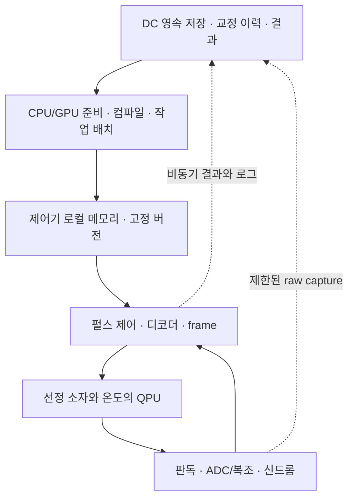

# AXON DC + QPU — 저장·상태 준비·실시간 제어 통합 설계

작성일: 2026-10-30 KST. 이 문서는 추가 제공된 DC/메모리 융합 설명을 검토한 제안이다. AXON-FS·CORAL·광 T-RAM의 현재 구현이나 특허 청구항은 이번에 확인하지 않았다.

**전체 판정: 고전 저장소·CPU/GPU·제어기·QPU의 결합은 타당한 설계 방향이다. 그러나 대규모 DC가 모든 QPU 동작의 필수조건은 아니며, 저장소의 광 출력이나 CXL 연결이 양자 상태 준비를 대체하지 않는다. 실시간 루프는 제어기 근처의 검증된 메모리에서 닫고, DC는 준비·분석·보관을 맡기는 구조를 권장한다.**

## 1. 추가 주장별 판정

| 주장 | 값 | 증거 라벨 | 적용 범위 | 비교 기준·조건 | 계산/출처 | 한계 | 판정 |
|---|---:|---|---|---|---|---|---|
| 측정하면 항상 물리 큐비트가 파괴됨 | 모든 측정 | [ASSUMED] | [GENERAL] 주장 | 측정 방식·관측량별 구별 | D3의 QND 예 | 상태 갱신과 소자 소멸을 혼동 | 반증됨 |
| 고전 host·제어·결과 저장이 필요 | 역할 분담 | [MEASURED] 외부 사례 | [GENERAL] | 실제 통합 시스템 범위 | AI/HPC 문서 A5 | 대규모 DC가 필수라는 뜻은 아님 | 조건부 가능 |
| 교정 테이블은 항상 TB급 | 수천 qubit | [ASSUMED] | [PROJECTED-AXON] | 파라미터 수·샘플·이력 정책 필요 | 아래 메모리 산식 | sparse parameter와 raw waveform/log 구별 | 미검증 |
| QPU 결과는 언제나 몇 byte | 단일 solution | [ASSUMED] | [GENERAL] 주장 | shots·raw IQ·syndrome·histogram에 따라 다름 | 데이터 계약 필요 | 결과 데이터 크기의 보편적 상한 없음 | 반증됨 |
| CXL이 고전 memory를 coherent qubit state로 로딩 | 직접 state preparation | [ASSUMED] | [PROJECTED-AXON] | classical transport와 quantum oracle 구분 | D1·D2 | CXL cache coherence는 quantum coherence가 아님 | 미검증 |
| 랙간 전체 광 전송 | 5.8ps | [DERIVED] 검산 | [PROJECTED-AXON] | 물리 길이·군굴절률 명시 | 1m·n_g=1.5이면 약 5ns 편도 | encoding·queue·PHY 지연 별도 | 반증됨 |
| 5-trit packing으로 모든 데이터가 10배 압축 | 1/10 | [ASSUMED] | [MLQT-ONLY] 주장 | 삼진 payload와 BF16 기준 한정 필요 | 아래 bpw 산식 | 일반 파일의 무손실 압축률·모델 품질 아님 | 미검증 |
| 광 PCM 메모리 read가 곧 quantum register write | 무변환 직결 | [ASSUMED] | [CPNPU/TRAM-DEPENDENT] | 광원·위상·검출·소자 인코딩 필요 | D2의 quantum query 구분 | 고전 광신호와 양자상태·게이트를 혼동 | 미검증 |
| AXON 부품으로 공급망까지 완전 독립 | 외부 의존 0% | [TARGET] | [PROJECTED-AXON] | 제조·PDK·laser·network·운영 SW 등 포함 | 구성품·라이선스 목록 없음 | 운영 자립과 공급망 자립이 다름 | 미검증 |

외부 사례의 측정은 AXON의 부품과 연결을 측정했다는 뜻이 아니다.

## 2. 무엇을 저장하고 무엇을 계산하는가

고전 메모리는 모델·Hamiltonian 표현·pulse program·교정 파라미터·결과를 보관한다. QPU는 알고리즘에 맞게 준비한 양자상태를 조작하고 측정한다. 양자 메모리 연구도 있으므로 QPU를 ‘저장 기능이 원천적으로 없는 연산기’로 정의하는 것은 부정확하다. 다만 QPU가 NVMe/NAS의 일반적인 파일 저장 기능을 대체하지는 않는다.

측정 후에는 관측량과 측정 방식에 따라 상태가 갱신된다. QND readout은 해당 관측량의 eigenstate를 보존할 수 있으며, 장치를 reset해 다시 사용할 수도 있다. 광자를 흡수하는 검출과 고체 큐비트의 QND readout을 같은 파괴 방식으로 묶지 않는다. [D3]

작은 QPU 실험은 제한된 host·controller·storage로도 가능하다. DC 규모는 모델 크기, 원시 로그 보존량, 동시 작업과 서비스 수준에 따라 정한다. 데이터센터를 크게 짓는 것 자체가 QPU의 계산 정확도나 속도를 보장하지는 않는다.

## 3. CXL은 고전 메모리 계층에 둔다

CXL 공식 설명 D1은 processor·memory expansion·accelerator의 cache-coherent interconnect이다. 여기서 coherence는 고전 cache consistency에 관한 것이며 qubit의 위상 결맞음과 다르다.

권장 경계는 다음과 같다.

1. NVMe/object store에서 필요한 classical data와 교정 버전을 읽는다.
2. host DRAM 또는 지원되는 CXL memory에 staging한다.
3. CPU/GPU가 Hamiltonian·회로·pulse schedule·decoder input을 생성한다.
4. controller가 검증된 program과 작은 작업 버퍼를 local SRAM/BRAM/DDR에 고정한다.
5. DAC/RF/laser 또는 적합한 quantum device interface를 통해 상태를 준비하고 제어한다.

qRAM은 중첩 주소에 대한 coherent query를 다루는 별도 구조이다. 원 논문 D2가 설명하는 qRAM을 일반 CXL memory expander와 동일하게 취급할 수 없다. 데이터 로딩·인코딩·oracle 생성의 비용은 별도 자원으로 기록한다.

광 T-RAM read가 고전적인 광 세기/위상 신호를 만든다 해도, 그것이 특정 qubit의 원하는 상태 준비나 유니터리 연산과 일치하는지는 증명해야 한다. classical optical data path가 detector를 거쳐 제어기에 들어가는 경우와 quantum state transfer는 서로 다른 기능이다.

## 4. 실시간 루프를 DC의 분산 파일시스템 밖에 둔다

아래는 제안 [TARGET]이다. hot path의 실제 지연·소자는 미검증이다.

QEC나 빠른 feedback을 수행할 때 매 pulse마다 remote file read·분산 lock·metadata lookup을 기다리는 구조는 피한다. 필요한 데이터는 작업 시작 전 local cache에 놓는다. run 중에는 calibration version을 고정하고, 업데이트는 명시적인 boundary에서 반영한다.

로그 전송은 비동기로 수행한다. 저장소가 일시 지연되더라도 real-time loop의 deadline이 깨지지 않도록 ring buffer·backpressure·보존 정책을 설계한다. buffer가 소진될 때 drop 가능한 telemetry와 실험 중단이 필요한 필수 데이터도 구별한다. 이 구조의 지연 개선은 측정으로 확인해야 한다.

## 5. 용량과 대역폭은 산식부터 정한다

교정 LUT 메모리의 단순 예는 `qubits×parameters_per_qubit×bytes_per_parameter`이다. 1,000Q×100 parameter×8 byte라는 가정에서는 **800,000byte=0.8MB**다. 버전 이력·주파수 sweep·raw IQ·waveform을 보관하면 증가하지만, qubit 수만으로 TB를 선언할 수 없다.

raw waveform 저장의 별도 예는 `channels×sample_rate×duration×bytes_per_sample`이다. 3,000채널×1GS/s×1ms×2byte라는 가정은 **6GB**다. 이 계산은 모든 채널이 해당 구간을 조밀하게 저장한다는 가정이며 실제 구현의 압축·공유 envelope·DDS/LUT 재사용은 포함하지 않는다. 반복 신호를 매번 DC에서 스트리밍해야 한다는 뜻도 아니다.

**MLQT 5-trit payload:** 5개의 삼진 값은 3^5=243개 조합이고 1byte에 담을 수 있다. 이때 8/5=1.6bit/value이다. BF16 16bit/value와 비교하면 raw payload 기준 10배다.

예를 들어 이미 삼진화된 100B개 가중치의 packing은 100×10^9×1.6/8=20GB이다. 비교 BF16 payload는 200GB다. 이 계산은 압축 후 품질을 보장하지 않는다. scale·metadata·residual·alignment·runtime buffer·KV cache 등은 별도이고, 음악·영상·일반 문서에 동일한 10배 무손실 압축률을 적용할 수 없다. [THEORETICAL/DERIVED][MLQT-ONLY]

최소 전송 시간은 `payload bytes / sustained bytes_per_second` 이상이다. 별도로 전파 지연도 있다. n_g=1.5라는 가정에서 1m 광섬유는 편도 약 5.003ns, 10m는 약 50.03ns다. PHY·switch·serialization·memory access·queueing은 이 위에 더해진다. 500μm PIC 경로의 5.8ps를 전체 memory-to-QPU 지연으로 사용하지 않는다.

## 6. 영속 기억의 범위

CORAL 또는 AXON-FS를 사용한다면 아래는 구현 확인 전 [TARGET] 요구사항이다.

- job ID, code/firmware hash, calibration version, input digest, circuit/pulse program version을 결과와 연결한다.
- raw shots·syndrome·IQ capture·집계 통계를 구별하고 retention policy를 정한다.
- 오류·실패·재교정·성능 퇴행 이력을 보존한다.
- checksum·backup·복구 시험을 정의한다. 영속성은 파일 이름이나 압축 방식만으로 얻어지지 않는다.
- ‘세계 지식 전체’ 같은 무한한 요구 대신 데이터셋 범위·권한·품질·갱신 정책을 정의한다.

## 7. 독립성은 세 단계로 정의한다

| 목표 | 의미 | 필요한 검증 |
|---|---|---|
| 운영 자립 | 외부 cloud API 없이 현장에서 host·QPU·storage 운용 | offline job 실행·교정·복구 |
| 소프트웨어 통제 | scheduler·codec·controller·compiler 변경 가능 | source·license·build/release·유지보수 체계 |
| 공급망 자립 | 칩·광소자·냉각기·제조·패키징·부품까지 자체 조달·생산 | BOM 원산지·제조 역량·대체 공급망 |

첫 단계는 의미 있는 목표다. 이 목표가 달성되어도 다른 두 단계나 외부 기술 의존 0%가 자동 성립하지 않는다. 제품 문구에는 달성한 독립성의 범위를 적는다.

## 8. 수정 문구·누락 근거·최소 다음 실험

**수정 문구:**

> AXON DC는 모델·실험 데이터·교정 이력을 보관하고, CPU/GPU 및 로컬 제어기가 상태 준비와 실시간 처리를 담당하며, QPU는 검증된 특정 양자 workload를 수행한다. 광 인터커넥트와 CXL은 고전 데이터 이동의 후보 기술이며, quantum state preparation과 소자 인터페이스는 별도 검증한다. 외부 cloud 없이 운영 가능한 통합 연구 인프라를 목표로 한다.

**누락 근거:** 실제 AXON-FS/CORAL 및 광 T-RAM 구현, interface spec, data format·address/encoding 계약, sustained throughput, latency distribution, calibration schema와 retention policy, 양자 oracle/state preparation 회로 및 end-to-end 자원표.

**최소 다음 실험:** 실제 QPU 없이 host→local controller memory→pulse/measurement emulator→async log의 한 작업을 실행한다. calibration version을 고정하고 저장소 전송을 지연시켜도 hot loop의 deadline이 유지되는지 검사한다. 평균/p99 지연·buffer 점유·누락 로그·메모리 사용량을 기록한 뒤 실제 QPU interface를 교체해 넣는다. 이것이 DC 결합 구조를 저비용으로 검증하는 첫 단계다.

## 9. 추가 출처

- **D1** CXL Consortium, About CXL. https://computeexpresslink.org/about-cxl/
- **D2** Giovannetti, Lloyd & Maccone, Quantum random access memory, Phys. Rev. Lett. 100, 160501 (2008). https://arxiv.org/abs/0708.1879
- **D3** NTT 연구진의 QND 연구 설명, Theoretical and Experimental Study of Quantum Nondemolition Measurement Using an Electric Circuit (2012). https://www.ntt-review.jp/archive/ntttechnical.php?contents=ntr201209fa3.html

수치 예제는 명시된 입력의 계산이며 AXON 하드웨어의 실측이 아니다.
