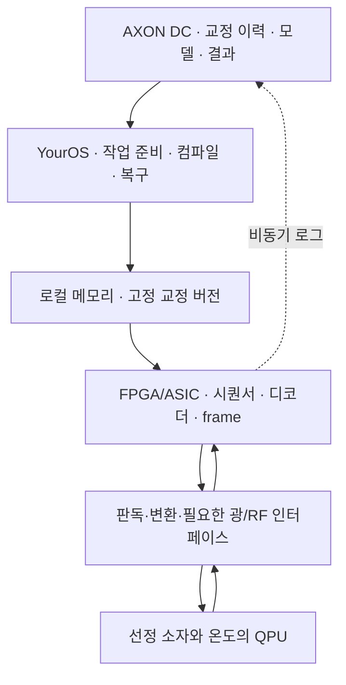

# AXON-SQA-01 v0.3.1 — 양자·고전 통합 아키텍처 개발 지침서

**개정일: 2026-10-31, Asia/Seoul. 상태: 문서·참조 코드·검증 계약 개정본. 실제 양자 시스템 완성 또는 성능 실증 선언이 아님.**

> 완벽함을 선언하는 대신, 근거를 기억하고 오류를 교정하며 검증된 개선을 축적한다.

## 0. v0.3.1 감사 보완

소프트웨어 기준선과 M3 로컬 보고의 범위는 `AUDIT_ADDENDUM.md`, `LOCAL_AUDIT_RECEIPT.json`으로 보완한다. 원본 세 커밋은 사용자 보고로 기록했으며 미확인 상태는 원시 근거 접수 전을 의미한다. 이전 결과를 무시하거나 허위로 판정한 것이 아니다.

배포 당시 `results/`는 snapshot이다. 새 실행 결과는 `runs/latest/`에 쓴다. 실행 전에 source manifest를 검사하고 전체 배포 snapshot 검사는 `release_integrity.py snapshot`으로 한다. 소스·문서·입력을 바꾸면 제작자가 검토·검증 후 새 버전과 manifest를 배포해야 한다.

`m3_intake.py`는 코드별 기능 계약과 동일 commit의 원시 근거를 접수한다. 자료 완결성이 맞는다는 판정은 측정 진위·의미·동치 인증이 아니다. 원본 M3·YourOS의 실제 수정이나 푸시는 이번 패키지에 포함되지 않는다.

## 1. 이번 개정의 결론

AXON DC, YourOS, 고전 QEC 디코더, 광 CPNPU를 통합하는 개발 방향을 유지한다. 실시간 실행은 검증된 FPGA/ASIC과 로컬 메모리에 맡기고, YourOS와 DC는 작업 준비·교정·기록·복구를 맡는다. 77K·4K·mK는 서로 다른 열수지와 부품 검증을 갖는 단계로 구별한다.

기존 설명의 `20 LUT`, `50 게이트`, `LTP 9`, `$mul=0`은 사용자 제공 보고의 수치이다. 원본 M3 RTL·합성 로그·대상 디바이스·제약을 확보하지 못했으므로 현재 실측 또는 재현된 합성값으로 등록하지 않는다. `0.5ns ASIC`, `1.5ns FPGA`, `5ns 전체 QEC`, `0W`, `4K 직접 실장`은 확인된 결과가 아니다.

이번에 완성한 범위는 개정 지침서, 공학 계산 코드의 오류 수정, 증거 완결성 검사기, 범위가 명확한 Steane 참조 디코더 및 재실행 가능한 검증 묶음이다. 원본 M3나 YourOS 커널을 수정·설치하거나 GitHub에 푸시한 것은 아니다.

## 2. 증거 계약

| 라벨 | 의미 | 허용 표현 |
|---|---|---|
| CODE-VERIFIED | 명시한 코드 기능을 시험함 | 이 입력 범위의 기능 시험 통과 |
| RTL-VERIFIED | 명시한 RTL·시뮬레이터·자극에서 검증 | 해당 RTL 시험 통과 |
| SYNTHESIZED | 특정 도구·타깃에 합성 | 보고된 합성 자원량·모델 기반 PPA |
| FPGA-MEASURED | 실제 FPGA 보드에서 계측 | 계측 조건의 FPGA 성능 |
| SILICON-MEASURED | 제작 칩에서 계측 | 해당 PVT·부하·패키지의 성능 |
| SIMULATED / DERIVED | 시뮬레이션·계산 | 가정과 모델의 결과 |
| ASSUMED / TARGET | 입력 가정·설계 요구 | 가정값·개발 목표 |
| UNKNOWN / NOT_EVALUATED | 입력 부재·평가 범위 밖 | 미확인·미평가 |

라벨과 출처 문장은 증거를 자동 인증하지 않는다. 해시는 파일 동일성을 확인할 뿐 측정 진위·방법의 적절성을 보증하지 않는다. `evidence_gate.py`의 `READY_FOR_REVIEW`도 사람이 검토할 자료가 갖춰졌다는 뜻이며 실측 인증이 아니다.

공개 문구는 동일 workload·정확도·정밀도·코드·거리·입출력 경계에서 비교한다. 파일 개수, 테스트 개수, 특허 번호, 내부 커밋만으로 성능·차별성·실현 가능성을 대신 입증하지 않는다.

## 3. 다섯 가지 수정 설계 원칙

### 3.1 선언한 디지털 연산 영역의 0-MUL

전용 디지털 datapath에 삼진 Sign-Select, XOR, 패리티, LUT, 필요한 Shift-Add를 사용한다. 모든 주변장치나 아날로그 믹서·광학 작용까지 곱셈이 없다는 뜻은 아니다. QEC는 MLQT를 반드시 사용해야 하는 작업도 아니다.

0-MUL 확인에는 매핑 전 `$mul/$macc`·추론 연산자와 매핑 후 DSP·구조 검토를 함께 기록한다. 최종 netlist에서 `$mul=0`이라는 사실만으로 물리 곱셈 구조 부재를 판정하지 않는다. 일반 게이트로 풀린 곱셈도 검토 대상이다. [S1, S2]

에너지는 별도 검증한다. 일반적인 CMOS 근사 `P_dynamic ≈ α C V² f`에 누설·단락·clock·메모리·I/O 등을 더해야 한다. 0-MUL은 0W가 아니다. QEC의 공정한 기준선에는 XOR·LUT·matching·clustering 등 해당 문제에 적합한 기존 구현을 포함한다. [S4, S8]

### 3.2 광 링크는 열·지연을 줄일 후보 인터페이스

기본 후보는 차폐·열고정·필터링이 가능한 광섬유 링크이다. PAT-35로 지칭된 자유공간 반사 캡은 별도 실험 경로로 둔다. 두 경로를 동일한 완성 인터페이스로 서술하지 않는다. 특허 원문·청구항을 확인하기 전에는 번호를 내부 자산 연결표로만 사용한다.

광섬유를 사용해도 광흡수, 검출기 전력, 지지구조 전도, 복사, 전원 인입은 남는다. 광학 창·반사 캡은 정렬·시야각·산란광·복사 유입·다중반사·채널 간섭을 추가로 평가한다. 광 연결을 통한 초전도 소자 제어 연구는 존재하나 AXON의 구현을 입증하지는 않는다. [S5]

### 3.3 클래딩·패키지의 구체적 검증

광도파로 클래딩은 광모드 환경을 정하는 구조이지 외부 열 침투 전체를 차단하는 장치가 아니다. 실리카의 굴절률과 실리콘 도파로의 유효·군굴절률을 혼용하지 않는다. 열팽창·응력·접착·결합 손실·진공 적합성을 열사이클별로 확인한다. Rogers/PTFE·인듐·와이어본딩은 후보이며 일괄 적합 판정된 부품이 아니다.

### 3.4 실시간 루프의 시간 경계를 명시

`5ns`는 필요하면 특정 로컬 디지털 블록의 연구 목표로만 둔다. 판독부터 출력 또는 Pauli-frame 반영까지의 전체 QEC 목표는 선정한 QPU·코드·프로토콜 요구에서 정한다. 원격 OS·저장소·에이전트 호출은 이 루프의 필수 의존성에서 제외한다.

디코더가 처리율을 유지하는 것과 단일 결과의 응답시간은 다르다. 공개 실시간 QEC 연구도 복호·통신·제어 경계를 구분한다. Pauli-frame 추적으로 물리적 보정 펄스를 지연·생략할 수 있는 경우가 있으므로 모든 오류에 즉시 역위상 펄스를 요구하지 않는다. [S4, S9]

### 3.5 근거가 없으면 미확인 유지

전력·열·지연 입력의 `null`은 0으로 바꾸지 않는다. 가정값으로 장부가 닫혀도 실제 소자 동작이나 QEC 충실도를 PASS 처리하지 않는다. 실패·불일치·과부하 사례를 성공 결과와 함께 남긴다.

## 4. 수정 통합 아키텍처

이 그림은 기능 배치안이다. 광 CPNPU는 이득이 입증된 고전 연산·제어·인터페이스 블록에 선택적으로 배치한다. 신드롬 XOR만으로 충분한 부분에 큰 GEMV를 강제로 추가하지 않는다. CXL은 host의 고전 메모리 확장·데이터 이동에 사용하며, 큐비트 상태 준비는 별도 회로·프로토콜로 수행한다.

| 계층 | 위치·역할 | 검증 경계 |
|---|---|---|
| L4 DC·CORAL/Engram·CAMEL-Swarm | 실험 원장·장기 기억·재교정 제안 | 실제 구현·영속성·복구 별도 검증 |
| L3 YourOS·TLang/T-ASM | 작업·펄스·디코더 program 생성과 staging | ISA/ABI·범위·버전·자원 계약 |
| L2 로컬 디지털 제어 | FPGA/ASIC 시퀀서·디코더·메모리 | 상온부터 기능·타이밍·전력 검증 |
| L1 광·RF 인터페이스 | 변조·검출·변환·필터·신호 전달 | 링크 전체의 지연·에너지·신호 품질 |
| L0 QPU·열 패키지 | 대상 양자 소자와 냉각 단계 | coherence·gate/readout·논리 오류 |

300K host, 선택적 77K 고전 전자부, 검증 후의 4K 인터페이스, 소자별 저온 QPU는 별도이다. 일반적인 트랜스몬 QPU를 77K 또는 4K에서 동작한다고 전제하지 않는다. 77K 제어기 연구가 77K 양자 소자 구현을 뜻하지 않는다.

## 5. 지연·전력·열·광학 예산

### 5.1 시간 예산

전체 시간은 같은 이벤트 정의에서 다음 항목을 합한다.

`T = measurement/integration + ADC/demodulation + links + decoder/queue + DAC/driver + delivery`

디지털 신드롬 입력 이후를 측정했다면 앞선 판독 시간이 제외되었음을 적는다. 평균·p95·p99·관찰된 최대값·측정 해상도·샘플 수를 기록한다. 관찰 최대값은 형식적으로 입증한 WCET와 다르다.

`t = n_g L/c`에서 가정 `n_g=1.5`, `L=1m`이면 편도 약 5.003ns이다. 자유공간 1m는 진공 근사 편도 약 3.336ns이며 반사·왕복으로 실제 길이가 늘 수 있다. 칩 500μm에 가정 `n_g=3.48`을 쓰면 약 5.804ps이지만 이는 변조·검출·대역폭·settling을 제외한 전파 성분이다. GEMV 전체 완료 시간으로 사용하지 않는다. [DERIVED, 가정 입력]

LTP는 위상 경로 깊이다. ASIC 지연은 Liberty·PVT·slew/load·SDC·배선 모델을 넣은 STA로, FPGA는 정확한 part/speed grade와 배치·배선 후 보고서로 먼저 추정한다. 극저온에서 검증하지 않은 상온 라이브러리로 77K/4K 지연을 인증하지 않는다. [S1, S3]

### 5.2 열·전력 장부

각 냉각 단계에 control core, readout, DAC/RF, absorbed light, clock/memory, phase bias, regulator loss, support/feed, radiation, fiber conduction을 기록한다. 검출기에서 열로 변한 광에너지와 같은 에너지를 다른 항에서 중복 계산하지 않도록 경계를 적는다.

0.5W는 가능한 특정 단계의 목표 예산이지 1,000 큐비트 전체 시스템의 입증된 소비전력이 아니다. 냉각곡선의 해당 온도 가용 용량과 기존 부하를 확인한다. 4K의 W급 냉각과 mK의 μW급 냉각 예시는 제품·조건이 다르며 범용 상수로 쓰지 않는다. 실제 wall power에는 host, 광원, 전원, 냉동기·펌프 등 사용 경계를 포함한다. LN2 구매 시 생산·운송 에너지 경계도 구별한다. [S10, S11]

77K 이동도 증가로 Vdd=0.5V가 보장되거나 전력이 항상 75% 감소한다고 가정하지 않는다. 전압 변화의 V² 비례는 다른 조건이 일정한 동적 성분의 근사이며 문턱전압·주파수·누설·주변회로는 별도이다.

### 5.3 광학 보정

MZI dark port의 감소는 에너지 소멸이 아니다. 양쪽 출력, 손실, 흡수·종단 열을 장부에 포함한다. ER 45dB는 power ratio 약 3.162e-5, field ratio 약 5.623e-3이다. ER만으로 양자 gate fidelity를 판정하지 않는다.

MZI의 π 위상은 보편적인 노이즈 제거 장치가 아니다. 진폭·위상·파장·편광·상관관계와 출력 포트를 포함한 전달함수가 필요하다. 광 GEMV는 ADC/DAC, laser, 변조·검출, 정밀도와 task 품질을 포함해 비교한다.

## 6. AXON 다섯 기술의 통합 계약

| 기술 | 이번 지침서의 역할 | 금지할 확대 해석 |
|---|---|---|
| MLQT | 고전 가중치·LUT의 삼진화·패킹 후보 | 모든 데이터 무손실 10배, qutrit 양자상태 직접 저장 |
| TLang/T-ASM | 지원 연산·폭·overflow·시간 자원을 명시하는 program | 언어 채택 자체로 0-MUL 하드웨어·무지터 보장 |
| CORAL/Engram | 코드·교정·실험·실패 이력의 영속 원장 | 파일 존재만으로 재현성·영속성 보장 |
| CAMEL-Swarm | 비동기 진단·재교정 제안·실험 orchestration | ns QEC 루프 안의 agent 추론 |
| 야코비안 안정화 | 고전 제어 보정의 민감도·안정성 제약 후보 | norm≤1만으로 모든 양자 오류 상쇄 |

`||J||≤1`은 일반적으로 비팽창 조건이며 엄격 수축은 적절한 영역·노름에서 상수 `<1` 등 추가 조건이 필요하다. 시간 지연·잡음·actuator saturation·모델 오차를 포함해 고전 제어계 안정성을 검증한다. 유니터리 양자 진화에 고전 수축 조건을 그대로 적용해 양자 상태 오류가 사라진다고 결론내리지 않는다.

고전 trit의 세 기호와 qutrit의 세 기저는 대응표를 만들 수 있으나, 복소 진폭을 가진 임의 qutrit 상태는 trit 하나가 아니다. 5-trit/byte 코덱은 고전 데이터 형식이다.

## 7. M3의 재정의와 최소 기능 기준선

M3를 세 부분으로 분리한다.

1. **M3-F 기능:** 어떤 코드·거리·측정 모델을 처리하는지 정의하고 논리 오류를 평가한다.
2. **M3-P 구현:** 동일 기능의 기준선과 RTL 동치·자원·배치배선·전력 모델을 비교한다.
3. **M3-H 시스템:** 실제 판독·링크·feedback/frame·온도에서 계측한다.

이번 패키지의 `qec_reference.py`는 Steane [[7,1,3]]의 이상적인 단일 라운드 신드롬 참조이다. 신드롬 입력 6bit, X/Z 보정 마스크 각 7bit를 사용한다. 오류 없는 경우와 21개 단일 X/Y/Z 오류를 검사하고 4^7=16,384개 Pauli 패턴을 모두 분류한다. 다중 오류의 실패도 보존한다. 원본 M3와 같은 코드·기능인지 확인되지 않았으므로 기존 20 LUT 수치와 비교하지 않는다. [S6, S7]

이 참조는 fault-tolerant syndrome extraction, 측정 오류, leakage, 시간 이력, 실제 gate noise를 구현하지 않는다. 7개 data qubit 외의 ancilla 자원을 생략한 하드웨어 규모 주장도 금지한다. 보정 마스크 출력은 QEC 실행 완료가 아니다.

## 8. YourOS와 에이전트의 실행 경계

YourOS는 job ID·program hash·calibration hash·sequence·timeout·buffer 정책을 관리한다. IA32_LSTAR는 syscall 진입 주소이며 결정론적 타이밍 장치가 아니다. `0x3001` 같은 syscall 번호는 원본 확인 전 프로젝트 ABI 제안으로만 취급한다. Linux PREEMPT_RT의 존재를 무시한 경쟁 비교는 삭제한다. [S12, S13]

작업은 PREPARED→STAGED→ARMED→RUNNING→DRAINING→COMPLETE로 진행한다. 오류 경로는 FAULT/ABORTED로 남기며 자동 성공으로 덮어쓰지 않는다. ARMED 이후 입력 버전은 고정한다. 변경은 다음 작업 경계에서 반영한다. 실제 세부 계약은 `YOUR_OS_INTERFACE.md`에 적는다.

## 9. 세 가지 개발 경로

| 경로 | 장점 | 비용·한계 | 채택 조건 |
|---|---|---|---|
| A 상온 FPGA·전기 loopback | 기능·정확도·시간 경계를 먼저 검증 | 저온·광학 이득은 입증하지 않음 | 현재 우선 경로 |
| B 상온 제어 + 광섬유 + 저온 인터페이스 | 배선·열 문제를 분리해 측정 | 광변환·흡수·패키지 비용 | A 이후 링크 예산과 부품 근거 확보 |
| C 검증한 77K/4K 로컬 제어 | 지연·배선 감소 가능성 평가 | cryo 부품·열·패키지 검증 부담 | B 대비 실측 이득과 열예산 확보 |

PAT-35 자유공간 반사 캡은 B의 광섬유 기준선과 비교하는 별도 실험이다. 같은 BER·수신 품질·거리·온도·포트 수에서 delay, jitter, 에너지와 열을 비교한다.

## 10. 마일스톤과 현재 상태

| 단계 | 성공 판정 | 현재 상태 |
|---|---|---|
| P0 자산·주장 정리 | 원본 SHA·도구·출처·경계 확보 | 문서 개정 완료, 원본 M3 접근 미완 |
| P1 공학 장부 | 누락 보존·과부하·단위·오류 회귀검사 | 이번 코드와 테스트로 확인 |
| P2 제한 참조 QEC | 22개 단일 사례·전체 Pauli 분류·독립 상태벡터 대조 | 이번 참조 코드로 확인 |
| P3 원본 M3 RTL·PPA | 같은 코드/거리/noise·기준선·매핑·타이밍 | NOT_RUN |
| P4 상온 HIL | 실제 loopback·처리율·꼬리지연·전력 | TARGET |
| P5 광 링크 | 신호·열·지연·간섭·드리프트 예산 | TARGET |
| P6 극저온 부품·패키지 | 온도별 기능·열사이클·열수지 | TARGET |
| P7 실제 QPU | logical error·backlog·feedback/frame 실증 | NOT_EVALUATED |

배포 실행 결과는 `results/verification.json`과 `results/tests.log`, 새 재실행은 `runs/latest/verification.json`과 `runs/latest/tests.log`를 사용한다. 목표 달성 판단은 각 단계의 원시 증거가 채워진 뒤 갱신한다.

## 11. 외부 설명용 수정 문구

> AXON은 데이터센터의 영속 기억, YourOS의 작업 관리, 로컬 디지털 제어 및 광 인터커넥트를 결합하는 양자·고전 연구 구조를 개발한다. 특정 고전 연산의 곱셈 구조를 줄이고 배선·열·지연 부담을 개선하는 것이 목표이다. 현재 확보한 범위는 검토 문서, 공학 계산 모델과 제한된 QEC 기능 참조이며, 극저온 소자 동작·종단 간 QEC 성능·시스템 전력은 후속 검증한다.

1,000 물리 큐비트의 유용한 논리 큐비트 수는 코드·거리·오류율·프로토콜에 따라 계산한다. 2^1000 상태공간은 모든 해를 동시에 읽는 능력이 아니다. QAOA 1ms 최적해, HHL로 일반 attention 전체 O(log N), 정확도 100% 분자 계산, GPU DC 전체 대체는 이번 결과로 주장하지 않는다. 상세 기존 감사는 `legacy_v02/AI_AND_HPC_CLAIMS.md`에 보존한다.

## 12. 출처와 재현 근거

2026-10-31 기준 확인한 공식 문서·원논문이다. 각 자료는 관련 원리·외부 사례의 근거이며 AXON 성능 인증이 아니다.

- S1 YosysHQ, `ltp`: https://yosyshq.readthedocs.io/projects/yosys/en/0.31/cmd/ltp.html
- S2 YosysHQ, technology mapping source: https://github.com/YosysHQ/yosys/blob/main/techlibs/common/techmap.v
- S3 OpenSTA examples, delay·constraints·parasitics: https://openroad.readthedocs.io/en/latest/main/src/sta/doc/Examples.html
- S4 Caune et al., real-time QEC response-time experiment (2026): https://www.nature.com/articles/s41467-026-73331-6
- S5 NIST, Cryogenic Photonic Interconnects: https://www.nist.gov/programs-projects/cryogenic-photonic-interconnects
- S6 Steane, Multiple Particle Interference and Quantum Error Correction (1996): https://arxiv.org/abs/quant-ph/9601029
- S7 Steane, Simple Quantum Error Correcting Codes (1996): https://arxiv.org/abs/quant-ph/9605021
- S8 TI, CMOS Power Consumption: https://www.ti.com/lit/an/scaa035b/scaa035b.pdf
- S9 Google Quantum AI, below-threshold surface code and real-time decoding: https://www.nature.com/articles/s41586-024-08449-y
- S10 Bluefors, XLDsl-4K specifications: https://bluefors.com/products/4k-systems/xldsl-4k-measurement-system/
- S11 Bluefors, temperature-specific cooling specifications (2026): https://bluefors.com/news/increased-cooling-power-specifications-for-bluefors-dilution-refrigerators/
- S12 Intel SDM, system programming: https://www.intel.com/content/www/us/en/developer/articles/technical/intel-sdm.html
- S13 Linux kernel, PREEMPT_RT theory: https://www.kernel.org/doc/html/latest/core-api/real-time/theory.html

이전 v0.2는 `legacy_v02/`에 원형 보존했다. 해당 문서의 날짜·당시 접근 상태는 역사적 기록이다. 현행 지침은 이 파일과 v0.3.1 결과·계약을 따른다. 기존 특허 원문과 비공개 저장소 자산은 새로 검증하지 못했다.
